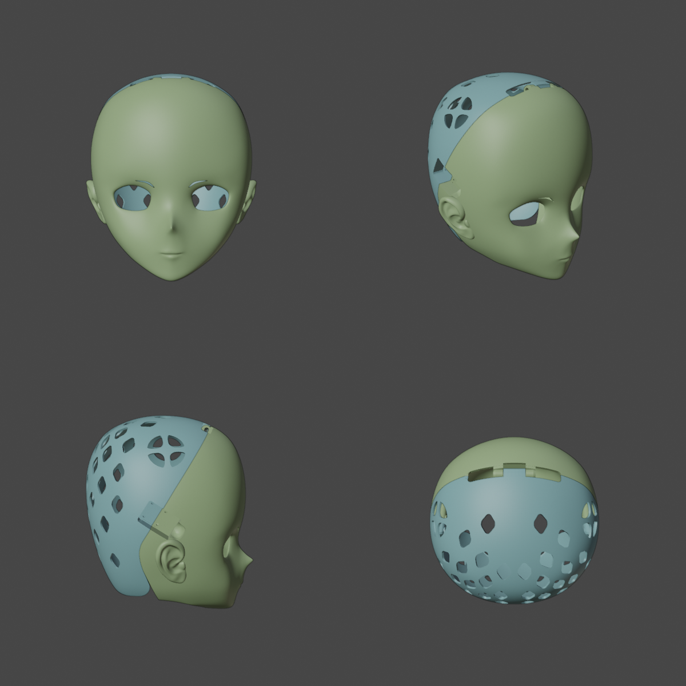

# 前脸 3 mm 打印版本（2026-10-22）

本版从 `ProjectPulsar_Base.blend` 的 Closure v4 装配生成，将前壳主体的 Solidify **名义厚度由 2.62 mm 调整为 3 mm**，偏移方向保持内侧。保留原有细分、布尔和拓扑清理流程，不改变脸型控制值。原始 Base 不改写。

## 文件

打印文件位于 `exports/2026-10-22-front-3mm/`，单位为 **mm**，切片时按 **100%** 导入，并将各件落到打印平台：

| 文件 | 用途 |
|---|---|
| `ProjectPulsar_Front_Closure_v4_Front3mm.stl` | 加厚前壳，打印 1 件 |
| `ProjectPulsar_Rear_Closure_v4_Front3mm.stl` | 配套后壳，几何与原 v4 相同，打印 1 件 |
| `ProjectPulsar_Hinge_Spacer_1p4.stl` | 1.4 mm 轴向垫套，打印 1 件 |
| `ProjectPulsar_Hinge_Test_Front.stl`、`ProjectPulsar_Hinge_Test_Rear.stl` | 顶部局部试打件 |
| `ProjectPulsar_SideLatch_Test_Front_L.stl`、`ProjectPulsar_SideLatch_Test_Rear_L.stl` | 左侧锁局部试打件 |

可编辑工程：[ProjectPulsar_Front3mm.blend](../variants/front-3mm/ProjectPulsar_Front3mm.blend)。前脸厚度源为隐藏对象 `头壳_前脸3mm` 的 `实体化` 修改器；前壳节点组中，预览和锁结构的头壳几何输入指向该对象，接缝与机械位置仍引用原始 `头壳`。后壳求值网格与原版的毫米坐标三角形哈希一致；耳部独立的 2 mm 厚度源、4 mm 侧锁承压区及铰链尺寸也保留。

该独立厚度源共享原始基础网格，但它的捏脸修改器参数是生成时的副本。后续改变脸型参数时，需要同步两个头壳源的对应参数，再重新运行验证。

## 厚度读数

3 mm 是实体化参数，不是细分后全表面的恒定厚度或最小壁厚保证。以下从最终前壳外表面沿局部三角面法线向内测量，并以反向射线复核端点：

| 取样位置 | 原版实测 | 加厚版实测 |
|---|---:|---:|
| 额头 | 2.57 mm | 2.94 mm |
| 眉鼻间 | 2.57 mm | 2.94 mm |
| 鼻尖 | 2.23 mm | 2.84 mm |
| 口部 | 2.38 mm | 2.75 mm |
| 下巴底部 | 2.49 mm | 2.85 mm |

完整端点与读数见[生成记录](front-3mm-build-2026-10-22.json)。这五点不是全域壁厚扫描，两位小数不是制造公差。

## 验证

- Blender **5.2.2 LTS** 保存并重新读取最终工程。
- [几何回归](front-3mm-regression-2026-10-22.json)：16 个重点场景通过。
- [机械装配](front-3mm-hinge-validation-2026-10-22.json)：0–80°、每 0.25° 共 321 个姿态通过；检查轴孔、装入通道、止退及四个姿态的独立实体求交。
- [侧锁](front-3mm-side-validation-2026-10-22.json)：8 个 Ø3.5 mm 通孔、两组 20 × 20 mm 孔距、4 mm 承压区通过。
- [网格 QA](front-3mm-asset-qa-2026-10-22.json)：前壳独立闭合曲面检查通过，原有四个耳内空腔与原版完全一致。检查在毫米坐标进行，避免把通用 QA 的米制阈值误当成 STL 顶点重合。独立检查空腔时仅翻转临时 QA 副本，交付网格保持正确的空腔绕序。
- [STL 清单](front-3mm-stl-manifest-2026-10-22.json)：七个 STL 均由 Blender 实际导出后重新读取，核对非空、尺寸、开放边、多面共边、绕序、重复面、退化面和正材料体积；每个文件记录 SHA-256。

前壳 **534,938** 个三角面，外包络约 **252.95 × 162.16 × 270.85 mm**；后壳 **134,282** 个三角面，外包络约 **236.55 × 177.40 × 248.53 mm**。前后壳分别存在 2 / 1 个面积小于 `1e-8 mm²` 的近零三角面，均高于仓库的退化阈值 `1e-12 mm²`，没有退化面。

QA 的已知限制：前壳主体超过通用工具 300,000 三角面的上限，因此该工具未执行其全量近共面配对检查；部件数、空腔一致性、打印拓扑和机械碰撞使用独立检查。未改动后壳保留 **2 对既有近共面提示**，不宣称其通用近共面 QA 通过。STL 无材质，保留装配坐标，缺材质与未落地提示属于预期。所有结果均为数字几何验证，未生成 G-code，未进行实际打印或装配测试。



## 复现

在仓库根目录执行。生成脚本要求输出不存在，避免覆盖现有工程；改用新路径时，后续命令也应保持一致。

```sh
BLENDER=/Applications/Blender.app/Contents/MacOS/Blender
"$BLENDER" -b --factory-startup --disable-autoexec --python-exit-code 1 \
  ProjectPulsar_Base.blend --python tools/build_front_thickness.py -- \
  --output variants/front-3mm/ProjectPulsar_Front3mm.blend \
  --receipt docs/front-3mm-build-2026-10-22.json \
  --wall-reference docs/head-vertical-section-dimensions-2026-10-22.json

"$BLENDER" -b --factory-startup --disable-autoexec --python-exit-code 1 \
  variants/front-3mm/ProjectPulsar_Front3mm.blend --python tools/validate_model.py -- \
  --output docs/front-3mm-regression-2026-10-22.json
"$BLENDER" -b --factory-startup --disable-autoexec --python-exit-code 1 \
  variants/front-3mm/ProjectPulsar_Front3mm.blend --python tools/validate_top_hinge.py -- \
  --output docs/front-3mm-hinge-validation-2026-10-22.json
"$BLENDER" -b --factory-startup --disable-autoexec --python-exit-code 1 \
  variants/front-3mm/ProjectPulsar_Front3mm.blend --python tools/validate_side_latches.py -- \
  --output docs/front-3mm-side-validation-2026-10-22.json
"$BLENDER" -b --factory-startup --disable-autoexec --python-exit-code 1 \
  variants/front-3mm/ProjectPulsar_Front3mm.blend --python tools/validate_front_thickness.py -- \
  --base ProjectPulsar_Base.blend --output docs/front-3mm-asset-qa-2026-10-22.json \
  --images docs/images --qa-scripts /path/to/blender-asset-qa/scripts
"$BLENDER" -b --factory-startup --disable-autoexec --python-exit-code 1 \
  variants/front-3mm/ProjectPulsar_Front3mm.blend --python tools/export_top_hinge.py -- \
  --validation docs/front-3mm-hinge-validation-2026-10-22.json \
  --side-validation docs/front-3mm-side-validation-2026-10-22.json \
  --exports exports/2026-10-22-front-3mm \
  --manifest docs/front-3mm-stl-manifest-2026-10-22.json --variant Front3mm
```
