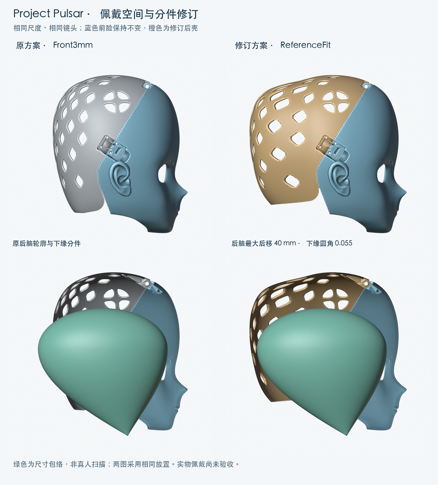
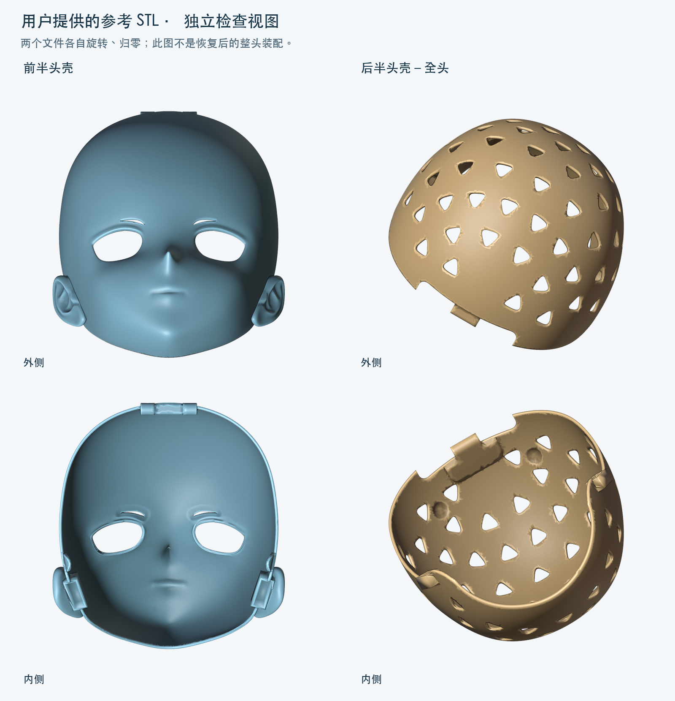
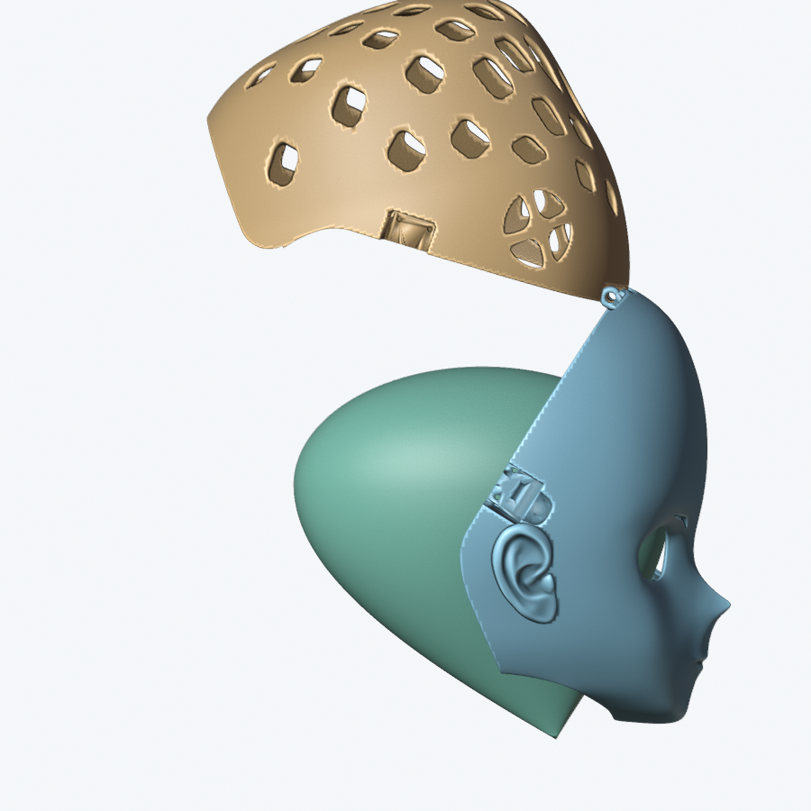

# 参考头壳后的佩戴空间与分件修订（2026-10-24）

> **已弃用，不作为当前方案。** 用户随后明确要求“不按头模测试，照抄提供的后壳数据”。本文件中的后移 40 mm、圆角 0.055 及头模验收仅为历史试验，不再用于决定当前后壳。当前以[后壳原样采用方案](REFERENCE_REAR_EXACT.zh-CN.md)为准。

本轮依据用户提供的 `前半头壳.stl`、`后半头壳-全头.stl`，按用户确认的“优先改善佩戴空间和分件结构”调整方案。采用独立的 **ReferenceFit** 版本：保留 Front3mm 的前脸、眼位与五金规格，扩展后脑空间，并加大后壳下缘的避让缺口。

这是数字样机。参考头壳不是佩戴者扫描；现有头高、头宽、头围也不能唯一确定真人头长和轮廓。下文将实测模型数据、采用的设计值、包络验证和未完成的实物验证分别列出。

## 文件与版本选择

- 可编辑工程：[ProjectPulsar_ReferenceFit.blend](../variants/reference-fit/ProjectPulsar_ReferenceFit.blend)。
- 打印试验用导出：`exports/2026-10-24-reference-fit/`，各件单位按毫米，100% 导入，分别落到打印平台。
- 基线：[ProjectPulsar_Front3mm.blend](../variants/front-3mm/ProjectPulsar_Front3mm.blend)，原始 Base 和 Front3mm 文件保留。
- [构建与参考文件记录](reference-fit-build-2026-10-24.json)、[佩戴空间验证](reference-fit-validation-2026-10-24.json)、[剖面测量](reference-fit-sections-2026-10-24.json)。

| 导出文件（均在上述导出目录） | 数量／用途 |
|---|---|
| `ProjectPulsar_Front_Closure_v4_ReferenceFit.stl` | 前壳，1 件 |
| `ProjectPulsar_Rear_Closure_v4_ReferenceFit.stl` | 后壳，1 件 |
| `ProjectPulsar_Hinge_Spacer_1p4.stl` | 顶部轴向垫套，1 件 |
| `ProjectPulsar_Hinge_Test_Front.stl`、`ProjectPulsar_Hinge_Test_Rear.stl` | 顶部局部试打件，各 1 件 |
| `ProjectPulsar_SideLatch_Test_Front_L.stl`、`ProjectPulsar_SideLatch_Test_Rear_L.stl` | 左侧锁局部试打件，各 1 件 |

前壳 **534,938** 个三角面，后壳 **115,750** 个三角面。后壳是一个封闭材料部件；七份 STL 均经实际导出后回读。STL 按仓库惯例作为本地产物保留，Git 记录工程、脚本、配图和哈希清单。



## 从参考模型采用什么

两个输入 STL 都分别通过了实际坐标下的基础拓扑检查：开放边、多面共边、绕序异常、重复三角面与退化三角面均为 0。它们已经分别旋转、归零，因此下面是**原始文件坐标的包围盒**，不能相加成整头尺寸，也不能直接作为内部佩戴净空。

| 输入文件 | 三角面 | 原始 XYZ 外包络，mm | 材料几何体积 |
|---|---:|---:|---:|
| 前半头壳.stl | 276,410 | 244.33 × 230.28 × 190.37 | 257.69 cm³ |
| 后半头壳-全头.stl | 154,114 | 224.30 × 220.30 × 234.91 | 254.80 cm³ |

STL 本身没有单位元数据；本轮根据头壳尺度及项目惯例按毫米解释。源路径、文件大小和 SHA-256 保存在构建记录中，下载目录的原文件未改写，参考 STL 没有被纳入发布包。



参考提供的是结构方向：前脸与后脑分件、后脑由后壳包覆、拆分边界延伸到下缘。实际修订采用项目自身可编辑几何：不直接拼接参考后壳，不复制未核实尺寸的卡扣，也不把两个参考件的独立显示姿态当成已恢复的装配坐标。后脑扩展 40 mm 来自对本项目尺寸包络的试算，不是从参考 STL 读出的佩戴者尺寸。

## 修改后的结构

| 项目 | Front3mm 基线 | ReferenceFit 修订 |
|---|---|---|
| 前脸 | 名义 Solidify 3 mm | 求值网格保持一致，外形、耳部和眼孔不变 |
| 后脑空间 | 原后壳 | 后脑区域最大向后位移 40 mm |
| 下缘避让 | 后壳「圆角位置」0.037 | 调整到 0.055，扩大下缘缺口 |
| 主分缝定位 | 前后基准值 0.78 | 保持 0.78；顶部和侧锁配合区保持原定位 |
| 顶部连接 | Ø6 × 55 mm 肩轴、M5 尾牙；Ø6.6 mm 孔 | 规格不变，重新验证运动与装入通道 |
| 两侧锁 | 20 × 20 mm 孔距、8 个 Ø3.5 mm 孔、4 mm 承压区 | 规格不变，重新逐孔测量 |

后壳新增「后脑空间 / 参考壳结构修订」几何节点修改器，可见参数为「后脑扩展 mm」。位移只沿模型 `-Y`：`Y ≥ -45 mm` 不移动，`Y ≤ -110 mm` 完整移动 40 mm，中间使用五次平滑插值。前壳最靠后的点约为 `Y=-36.20 mm`，现有五金最靠后约为 `Y=-33.45 mm`，均在固定区域内。此处没有统一缩放壳体或五金孔。

下缘圆角调整使后壳最低 Z 从约 **-89.94 mm** 变为 **-75.13 mm**，这是最低点坐标的变化，不表示整条边都抬高相同距离。底部缺口是分件结构的改动，主分缝与铰链位置保持原基准。新增极小边清理仅作用于本版布尔输出的指定局部，见验证记录。

调节后脑扩展、圆角、前后基准或脸型后，必须重新做几何、佩戴、开合与导出检查；本轮证据只对应记录中 SHA-256 标识的工程。

## 得到的空间与代价

以下在 `X=0` 正中切面，从内部向前后壳分别发射射线，测量壳壁之间的净深。数值不含内衬、五金和打印偏差，不是全壳最小净空。

| 模型高度 | 原版净深 | 修订净深 | 增加 |
|---|---:|---:|---:|
| Z = -60 mm | 207.47 mm | 241.83 mm | 34.36 mm |
| Z = 0 mm | 211.86 mm | 251.86 mm | 40.00 mm |
| Z = +80 mm | 217.39 mm | 257.39 mm | 40.00 mm |

前壳外包络仍为约 **252.95 × 162.16 × 270.85 mm**。后壳由约 **236.55 × 177.40 × 248.53 mm** 变为 **236.55 × 217.40 × 233.72 mm**。后壳材料几何体积由约 **225.60 cm³** 增至 **277.53 cm³**，增加约 **23.0%**；两壳合计增加约 **10.0%**。这是实体网格体积，不等于切片后的耗材量、打印重量或时间。

后脑轮廓更长，底部包覆更短。该取舍用于给长头型包络和内衬留空间；真实头长补齐后，可以在同一节点参数中收回不需要的后脑长度，避免把宽松包络长期当成个体定制尺寸。

## 佩戴验证的准确范围

沿用项目原有两种参数包络：头高 **230 mm**、最大头宽 **135 mm**（不含耳）、头围 **590 mm**、下巴至瞳孔 **127 mm**、瞳距 **65 mm**。头围截面假设在下巴以上 157 mm。椭圆截面的推算头长为 **233.95 mm**，方圆截面为 **212.26 mm**；均不是真人实测头长。

本轮两种包络均使用相同放置：左右居中，偏移 `(0, -27, -136) mm`，瞳孔位于模型 `Z=-9 mm`。默认工程没有把包络当作要打印的零件；剖视图的绿色体只用于说明。

- 两种包络与前后壳及全部已建模五金均无相交或完整包含；左右直视射线通过现有眼部开口。
- 以 **5 mm 内衬 + 2 mm 额外余量**为本轮设计预算，对包络三角面的所有内部点进行距离下界检查，而不是只测顶点。利用距离函数的 1-Lipschitz 性质和自适应细分，在 0.001 mm 数值扣减后，椭圆包络的认证下界为 **7.001 mm**，方圆包络为 **10.459 mm**。这些是保守下界，不是精确最小距离。
- 后壳从 0° 到 75°、每 5° 的 16 个姿态均未与包络相交；这是离散检查。
- 后壳保持打开 75°，包络沿 `+Y` 从后方平移 350 mm 到最终位置。起点、终点网格的凸包覆盖整个连续平移扫掠，凸包与已建模装配没有相交或包含，故该**简化头模的直线戴入路径**通过保守检查。



戴入结果不覆盖真人的鼻、耳、头发、颈肩、手部操作或软组织变形。不能因此声称真人一定戴得进去，也不能把“留了 5 mm 内衬预算”写成已经安装或测量了真实海绵。

## 数字验证与尚未完成的工作

最终记录以各 JSON 的 `passed`、源哈希及具体检查范围为准：

- [当前参数拓扑与 STL 回读](reference-fit-current-2026-10-24.json)。
- [标准 16 项几何回归](reference-fit-regression-2026-10-24.json)。该套回归沿用仓库标准输入矩阵；本版保存的 0.055 圆角由上一项及独立佩戴／机械检查另行验证。
- [顶部装配](reference-fit-hinge-validation-2026-10-24.json)：显式传入 `--rear-round 0.055`；0–80°、步长 0.25°，共 321 个姿态，另检查实体求交、轴向装入、工具通道和止退对照。
- [侧锁](reference-fit-side-validation-2026-10-24.json)：8 个通孔、两组孔距和承压厚度。
- [包络、壁厚与网格 QA](reference-fit-validation-2026-10-24.json)：后壳正常壳壁 **2,599 处**法线抽样范围约 **2.53–3.94 mm**。不把它解释成全域最小壁厚。
- [七份 STL 清单](reference-fit-stl-manifest-2026-10-24.json)：实际导出后回读尺寸、体积、拓扑和文件哈希。

通用 QA 的既有铰链近共面提示单独保留并说明：不能将打印拓扑与佩戴检查通过等同于通用 QA 的所有项目无提示。前壳保持原网格及四个既有耳内空腔；其通用大网格近共面检查仍有原版说明中的规模限制。新后壳的修改区域与未变机械区域分别核对。

最终通用后壳 QA 没有新增错误，保留 **1 对**与 Front3mm 基线坐标、三角面完全一致的铰链近共面提示；原始 `qa.pass=false` 如实保存在记录中，交付判定只接受经过逐面同一性核对的这一项。另以伪造的错误源哈希做负对照，导出器在创建输出目录前明确拒绝，避免把旧佩戴记录用于新工程。

尚未生成 G-code，未进行真实打印、内衬试装、商品搭扣活动盖碰撞、扭矩、承载、疲劳或真人佩戴验收。下一步先打印顶部与侧锁试件确认实物五金，再用低成本壳体验证头长、耳位、眼位与颈口，确认后再确定最终后脑扩展量和完整打印参数。

## 复现

使用 Blender 5.2.2 LTS，在仓库根目录运行。构建命令要求输出 `.blend` 不存在；复现已有交付时改用新的输出路径，并同步后续命令。

```sh
BLENDER=/Applications/Blender.app/Contents/MacOS/Blender
"$BLENDER" -b --factory-startup --disable-autoexec --python-exit-code 1 \
  variants/front-3mm/ProjectPulsar_Front3mm.blend --python tools/build_reference_fit.py -- \
  --output variants/reference-fit/ProjectPulsar_ReferenceFit.blend \
  --receipt docs/reference-fit-build-2026-10-24.json \
  --reference-front /path/to/前半头壳.stl --reference-rear /path/to/后半头壳-全头.stl

"$BLENDER" -b --factory-startup --disable-autoexec --python-exit-code 1 \
  variants/reference-fit/ProjectPulsar_ReferenceFit.blend --python tools/validate_reference_fit.py -- \
  --base variants/front-3mm/ProjectPulsar_Front3mm.blend \
  --qa-scripts /path/to/blender-asset-qa/scripts \
  --output docs/reference-fit-validation-2026-10-24.json

"$BLENDER" -b --factory-startup --disable-autoexec --python-exit-code 1 \
  variants/reference-fit/ProjectPulsar_ReferenceFit.blend --python tools/validate_model.py -- \
  --current --output docs/reference-fit-current-2026-10-24.json --exports /tmp/pulsar-reference-fit-check
"$BLENDER" -b --factory-startup --disable-autoexec --python-exit-code 1 \
  variants/reference-fit/ProjectPulsar_ReferenceFit.blend --python tools/validate_model.py -- \
  --output docs/reference-fit-regression-2026-10-24.json
"$BLENDER" -b --factory-startup --disable-autoexec --python-exit-code 1 \
  variants/reference-fit/ProjectPulsar_ReferenceFit.blend --python tools/validate_top_hinge.py -- \
  --rear-round 0.055 --output docs/reference-fit-hinge-validation-2026-10-24.json
"$BLENDER" -b --factory-startup --disable-autoexec --python-exit-code 1 \
  variants/reference-fit/ProjectPulsar_ReferenceFit.blend --python tools/validate_side_latches.py -- \
  --output docs/reference-fit-side-validation-2026-10-24.json
"$BLENDER" -b --factory-startup --disable-autoexec --python-exit-code 1 \
  variants/reference-fit/ProjectPulsar_ReferenceFit.blend --python tools/export_top_hinge.py -- \
  --validation docs/reference-fit-hinge-validation-2026-10-24.json \
  --side-validation docs/reference-fit-side-validation-2026-10-24.json \
  --fit-validation docs/reference-fit-validation-2026-10-24.json \
  --exports exports/2026-10-24-reference-fit \
  --manifest docs/reference-fit-stl-manifest-2026-10-24.json --variant ReferenceFit
```

配图由 `tools/render_reference_fit.py` 从保存的源网格重算，再以安装 Pillow 的 Python 运行 `tools/compose_reference_fit.py --images docs/images/reference-fit` 组合标题和说明。两个脚本的 `--help` 列出输入，所有渲染只在临时场景中进行，不修改输入工程。ReferenceFit 导出器要求装配、侧锁和佩戴三份通过记录均匹配当前工程哈希。
