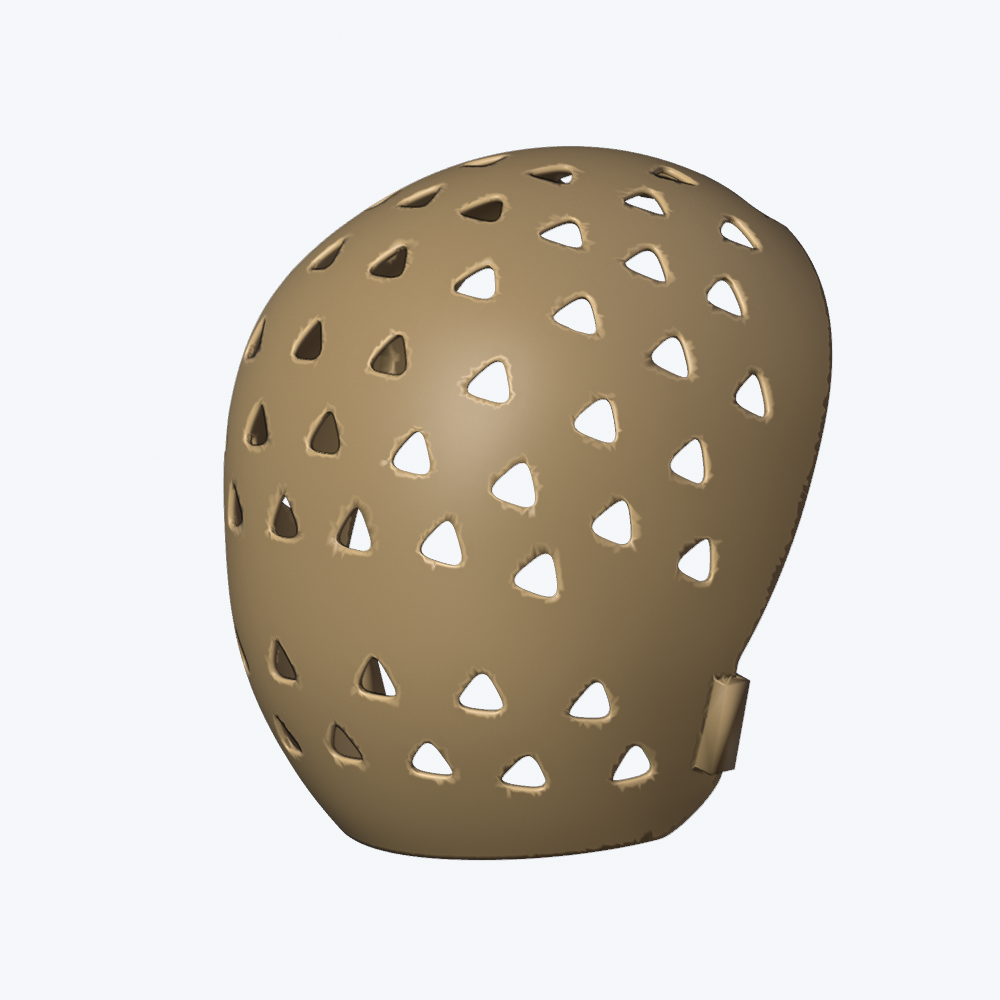
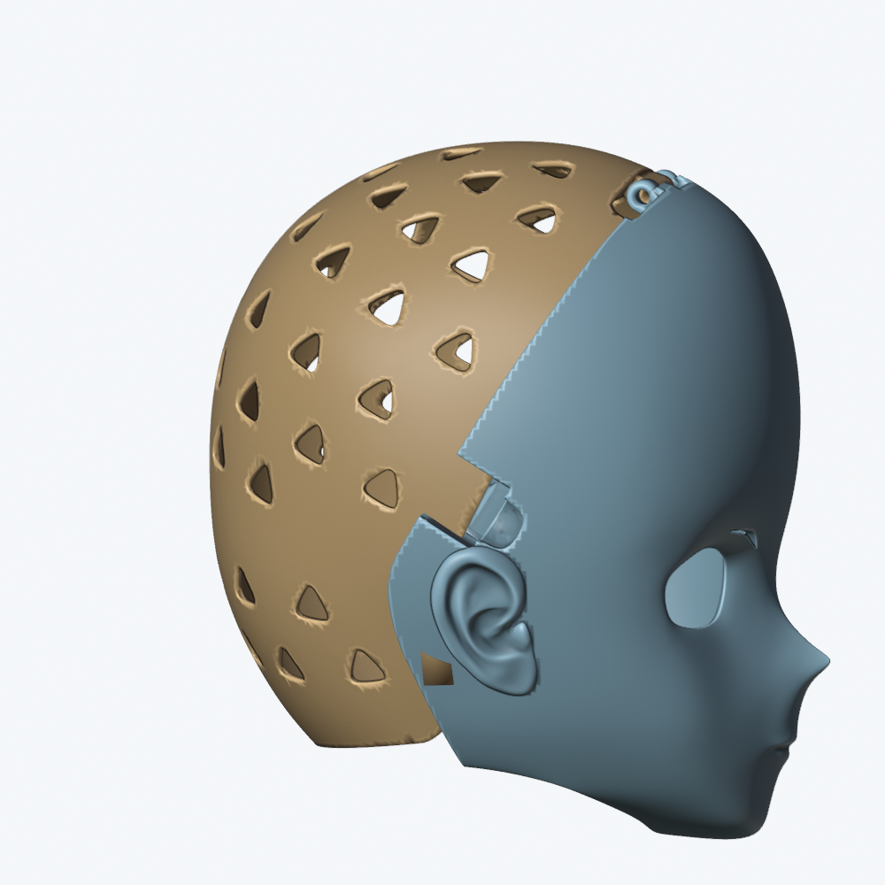

# 当前方案：后壳原样采用用户 STL

2026-10-24，按用户更正：“不要按头模测试，你照抄我给你的后壳数据”。当前后壳的唯一几何基准是用户提供的 **`后半头壳-全头.stl`**。

后壳的轮廓、尺寸、壁厚、通风孔、连接耳、卡扣和分缝边界全部保留原数据。没有头模拟合或测试，没有后移 40 mm，没有 0.055 圆角改造，没有放大、简化、重建、扩孔或局部网格修补。此前的 ReferenceFit 扩展方案已弃用，其文件和结果仅作为历史记录保留。

## 交付文件

- [原始后壳数据归档](../assets/reference/user-rear-2026-10-24/后半头壳-全头.stl)。
- [独立 Blender 工程](../variants/reference-rear-exact/ProjectPulsar_ReferenceRearExact.blend)。
- [原样 STL 交付文件](../exports/2026-10-24-reference-rear-exact/后半头壳-全头_原样.stl)。该导出按项目惯例仅在本地保存，源归档和工程纳入 Git。
- [源文件、保存回读与一致性记录](reference-rear-exact-2026-10-24.json)。



## 原样一致性

下载目录原文件、仓库源归档、交付 STL 三者**逐字节相同**。STL 的头部、原始法线字段、三角面顺序、坐标和绕序全部保留，不经 Blender 重新导出器重写。

SHA-256：

```text
3dd5067826cda886d7c03bbe10719db12acdf16de927f5adbf7b1bd4783fff39
```

| 核对项 | 结果 |
|---|---:|
| 文件大小 | 7,705,784 字节 |
| 唯一顶点数 | 76,900 |
| 三角面数 | 154,114 |
| 原始 STL 坐标的 XYZ 外包络 | 224.3046 × 220.2993 × 234.9098 mm |
| 材料几何体积 | 254.8032 cm³ |
| 开放边／多面共边／绕序异常 | 0 / 0 / 0 |
| 重复三角面／退化三角面 | 0 / 0 |
| Blender 保存后重新打开，逐三角面坐标及绕序比较 | 完全一致 |

STL 没有单位元数据，本项目按毫米解释。上表是原文件坐标轴的包围盒，不转换为未经确认的佩戴尺寸。Blender 的新场景采用 `scale_length=0.001`，原生网格直接存储 STL 毫米坐标，物体缩放为 1，避免先转成米再转回来造成坐标舍入。

源网格通用 QA 有 **1 对近共面提示**及 **1 对相背面提示**，原始结果如实保存在 JSON；本轮按“原样采用”保留这些源数据，不以清理提示为由改动后壳。缺材质提示对 STL 属正常情况。本轮通过的是数据一致性与基础拓扑核对，不声称源文件的通用 QA 无任何提示。

## Blender 工程中的场景

| 场景 | 用途 |
|---|---|
| `后壳照抄_原始STL坐标` | 原样后壳的权威网格，保持原始坐标，无修改器 |
| `接口对照_后壳原样_非装配验收` | 同一网格仅旋转、平移以便观察；默认突出显示后壳 |
| `历史Front3mm_前壳编辑源_旧后壳不用` | 保留原前壳的编辑来源；旧后壳明确标为历史对象 |

原样对象为 `后半头壳_用户原始数据_不变形`。接口对照对象共享它的 Mesh 数据块，没有另做一份缩放或变形后的后壳。对照场景中的 `前壳3mm_接口对照_未适配` 默认隐藏，需要查看时单独显示。

## 接口处理原则

**后壳数据固定，前壳接口及五金需要以该数据为基准适配。** 当前没有为了迁就旧版五金而扩大后壳轴孔、移动卡扣或修改分缝。

从源后壳长圆柱边拟合得到的顶部轴孔直径约 **4.278 mm**，圆拟合最大残差约 **0.0021 mm**。这是源几何读数，不是制造公差；它与旧 Closure v4 的 Ø6.6 mm 孔、Ø6 mm 肩轴规格不同，旧五金方案不能直接沿用。

接口对照场景先对齐测得的顶部轴线，再绕轴旋转比较，始终只有刚体旋转和平移。当前摆放与旧 Front3mm 前壳存在表面相交，因此**这张对照图不能作为已匹配的整套装配或打印方案**。本轮没有擅自改变前脸或后壳来消除这些差异。



此前基于头模得到的 7 mm 净空、40 mm 扩展量、321 姿态运动检查和旧七件套结果，均不用于验收这份原样后壳。后续接口设计须保留本文件定义的后壳数据基准。

## 复现

构建脚本要求输出 `.blend` 不存在；复现时改用新路径。该脚本不导入或执行头模测试。

```sh
/Applications/Blender.app/Contents/MacOS/Blender \
  -b --factory-startup --disable-autoexec --python-exit-code 1 \
  variants/front-3mm/ProjectPulsar_Front3mm.blend \
  --python tools/copy_reference_rear.py -- \
  --reference assets/reference/user-rear-2026-10-24/后半头壳-全头.stl \
  --source-copy assets/reference/user-rear-2026-10-24/后半头壳-全头.stl \
  --output variants/reference-rear-exact/ProjectPulsar_ReferenceRearExact.blend \
  --export exports/2026-10-24-reference-rear-exact/后半头壳-全头_原样.stl \
  --receipt docs/reference-rear-exact-2026-10-24.json \
  --images docs/images/reference-rear-exact \
  --qa-scripts /path/to/blender-asset-qa/scripts
```
