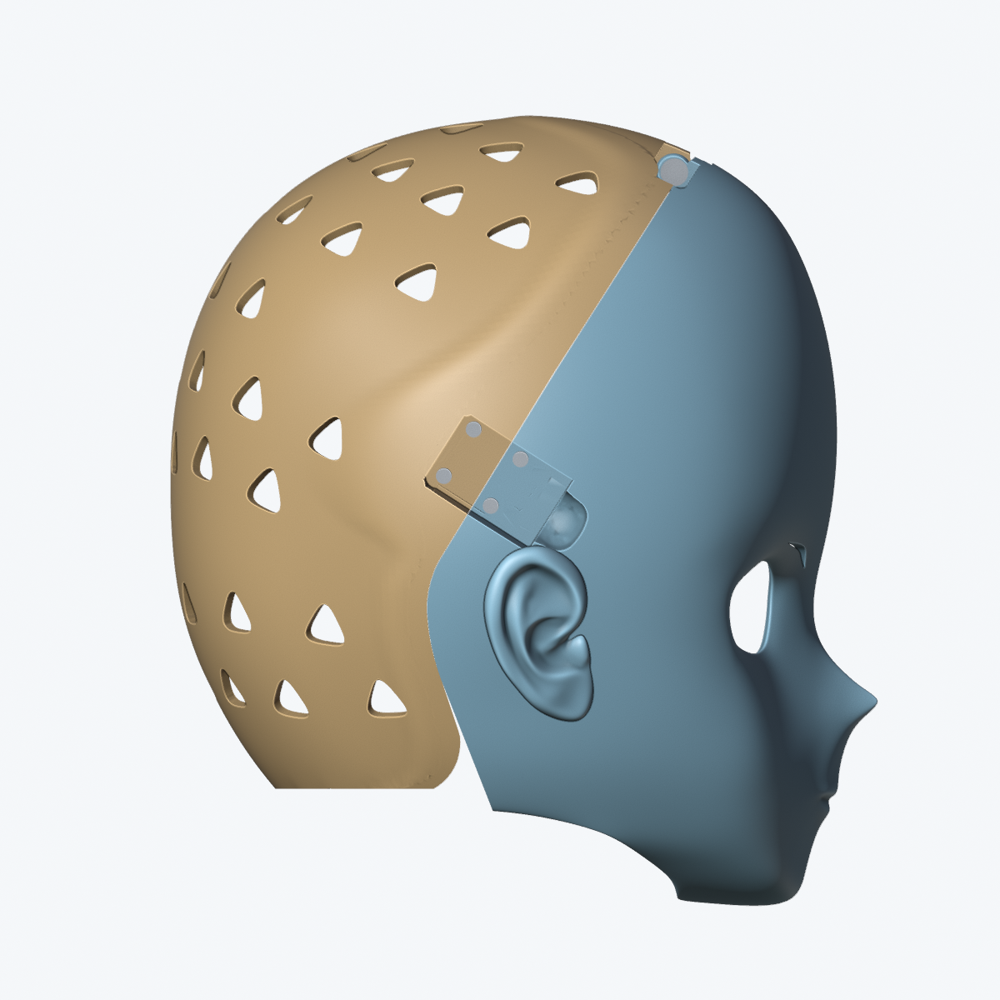
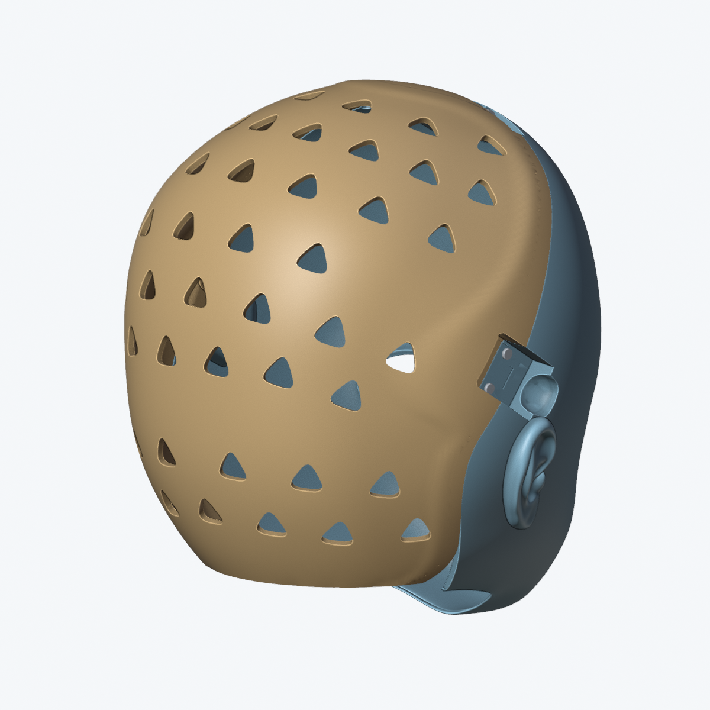
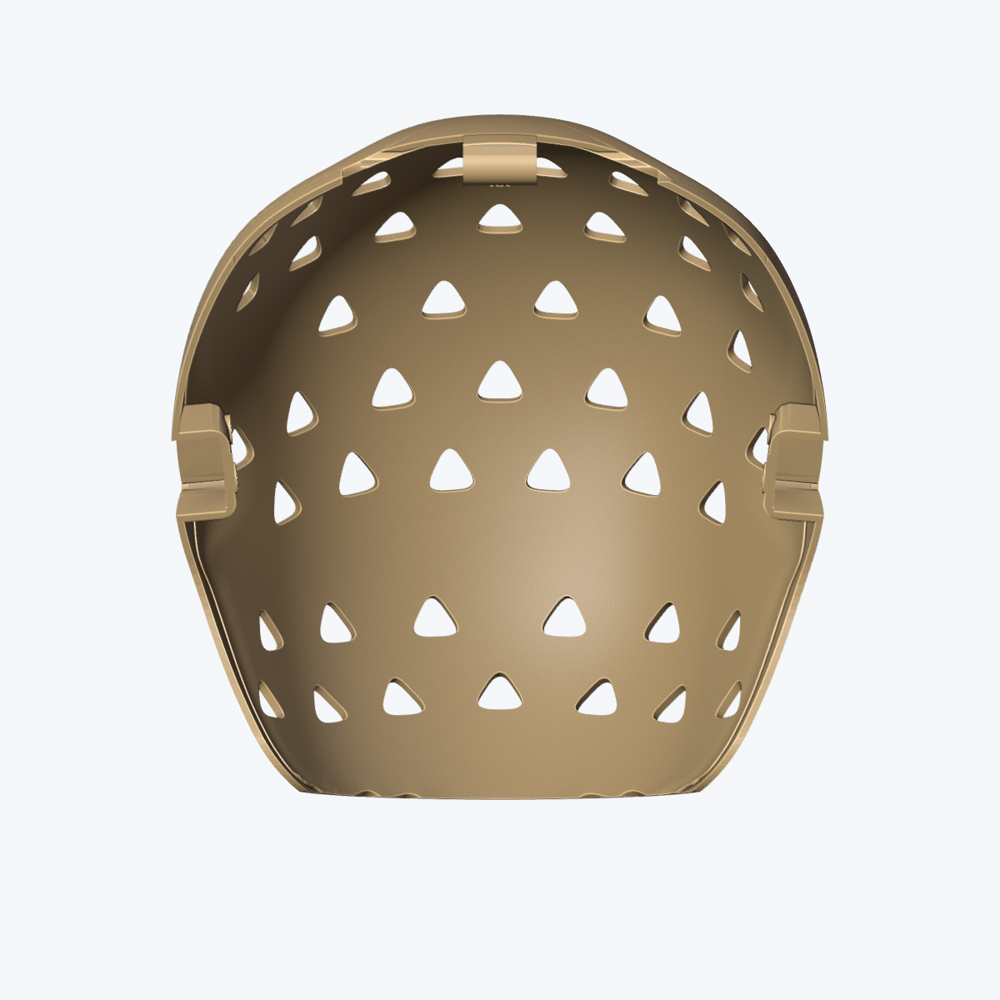

# 圆润后壳、原版对接分缝与五金

本版本对应最新要求：后壳为连续、圆润的曲面，与现有 Front3mm 前脸沿原版分缝对接；删除截图标出的两处下方废弃凸块，锁扣安装位和顶部铰链沿用原版。没有加载或使用头模。

## 文件与适用范围

- 可编辑装配工程：`variants/reference-rear-rounded/ProjectPulsar_ReferenceRearRounded.blend`。
- 打印文件：`exports/2026-10-24-reference-rear-rounded/`；前壳、后壳、1.4 mm 垫套和四个局部试打件分别导出。
- 该后壳搭配 **Front3mm** 前壳及原版 Ø6×55 mm／M5 肩轴、20×20 mm 孔距搭扣。前脸打印几何及现有五金包络保留。
- `ProjectPulsar_Base.blend`、Front3mm 原工程、用户输入 STL 及 `dbc034d` 的原样采用工程均保留。本版是新的适配版本，不能称为与输入 STL 逐字节一致。

## 几何变化

使用用户后壳的外轮廓构建规则四边形曲面，经平滑和细分后形成圆润主体，主体 Solidify 名义壁厚为 3.2 mm。按参考模型的 52 个真实贯通孔保留圆角三角镂空；顶部两个旧五金盲孔保持实心，不误切成通风孔。

接缝、中央铰链筒和两侧锁扣孔／承压台来自原版后壳。靠近两侧分缝的曲面按原接口做圆滑过渡，这一带相对用户参考外表面的最大变化约 2.734 mm；它属于明确修改的接边区域，不能声称整壳原样保留或全域误差小于 2 mm。新壳面与原接口在真实空间内做实体连接。顶部内侧补足旧垫片和 M5 螺母工具通道，轴线、孔距及五金规格不变。下缘在装配坐标 Z = −84 mm 处收平，清除原过渡处的碎边与细尖角；这是对底部开口的明确修改。

工程中的 `圆润后壳_可编辑曲面与原始基准_不打印` 集合默认隐藏，保留可编辑四边形外皮、凸包参考、刚体定位后的原始用户后壳及原版分缝来源。`后壳配置` 是经验证的冻结打印网格；修改隐藏外皮不会自动更新它，需重新构建并复核。前脸继续保留原有参数化结构。

## 验证与边界

本次最终保存文件已通过以下检查：

| 项目 | 结果 |
| --- | --- |
| 后壳网格 | 143,854 个三角面，1 个连通实体；开放边、多面共边、重复面、退化面和严格自交均为 0 |
| 网格资产 QA | 通过；唯一提示为保留装配坐标、最低点不在 Z=0 |
| 主体壁厚抽测 | 2,913 条法线射线；最小 3.190 mm，中位 3.200 mm |
| 源后部主体轮廓 | 8,734 个样本；连续外皮最大距离 1.599 mm |
| 接边附近轮廓变化 | 最大 2.734 mm；为适配原前脸而重建的过渡区域 |
| 原分缝、铰链筒、锁扣座核心 | 与原版表面的距离检查通过（0.002 mm 判定阈值） |
| 前脸及旧五金 | 38 个对象的实际网格哈希与原 Front3mm 工程一致 |
| 开合 | 0–80°，每 0.25°，共 321 个姿态，无已建模部件碰撞 |
| 两壳实体交集 | 0°、40°、75°、80° 的独立布尔交集体积均为 0 |
| 锁扣 | 8 个 Ø3.5 通孔、两组 20×20 mm 实测孔距、4 mm 承压台及 M3 紧固件检查通过 |

最终检查结果和尺寸由同一保存工程的 JSON 记录提供：

- [构建与未改动对象哈希](reference-rear-rounded-build-2026-10-24.json)
- [网格、原接口、源轮廓和壁厚](reference-rear-rounded-quality-2026-10-24.json)
- [开合、轴向装入、工具通道与止退](reference-rear-rounded-hinge-2026-10-24.json)
- [两组孔距、通孔与承压台](reference-rear-rounded-latches-2026-10-24.json)
- [当前配置几何回归](reference-rear-rounded-regression-2026-10-24.json)
- [STL 重新读取及哈希清单](reference-rear-rounded-stl-manifest-2026-10-24.json)

壁厚抽测限定于远离孔侧壁和开口边的主体曲面，不把射线从通风孔侧壁穿出的距离当作内外壳壁厚，也不代表全域最小厚度证明。源轮廓对比使用开孔前的连续外皮，另行报告带孔成品的最近表面距离，不能表述成原三角网格或原内壁完全不变。

资产 QA 中保留装配坐标导致最低点不在 Z=0 的提示，这是为了保持前后壳和五金的共同定位；局部试打件另有明确平移。当前后壳为固定网格，`validate_model.py --current` 检查当前配置，不把旧后壳几何节点参数矩阵算作本版覆盖。

以上为数字几何检查。未进行实体打印、实物五金测量、扭矩、疲劳或承载测试；商品搭扣活动盖内部没有完整 CAD 数据。先用随附局部试打件核对实际五金和打印机公差。

## 真实几何预览

金色是后壳，蓝色是现有 Front3mm 前脸。







## 复现

在仓库根目录使用 Blender 5.2.2 LTS。新构建必须指定不存在的输出路径，避免覆盖原工程；下列路径是本次交付路径，重放时应改为新路径。

```sh
BLENDER=/Applications/Blender.app/Contents/MacOS/Blender
"$BLENDER" -b --factory-startup --disable-autoexec --disable-depsgraph-on-file-load \
  --python-exit-code 1 variants/front-3mm/ProjectPulsar_Front3mm.blend \
  --python tools/build_reference_hardware.py -- \
  --reference assets/reference/user-rear-2026-10-24/后半头壳-全头.stl \
  --registration docs/reference-rear-exact-2026-10-24.json \
  --output variants/reference-rear-rounded/ProjectPulsar_ReferenceRearRounded.blend \
  --receipt docs/reference-rear-rounded-build-2026-10-24.json
```

随后分别运行 `validate_model.py --current`、`validate_reference_hardware.py`、`validate_top_hinge.py`、`validate_side_latches.py` 和 `render_reference_hardware.py`。质量检查所需 `--qa-scripts` 指向本机 `blender-asset-qa/scripts`；各脚本的 `--help` 列出参数。

```sh
"$BLENDER" -b --factory-startup --disable-autoexec --disable-depsgraph-on-file-load \
  --python-exit-code 1 variants/reference-rear-rounded/ProjectPulsar_ReferenceRearRounded.blend \
  --python tools/export_top_hinge.py -- \
  --validation docs/reference-rear-rounded-hinge-2026-10-24.json \
  --side-validation docs/reference-rear-rounded-latches-2026-10-24.json \
  --reference-validation docs/reference-rear-rounded-quality-2026-10-24.json \
  --variant ReferenceRearRounded \
  --exports exports/2026-10-24-reference-rear-rounded \
  --manifest docs/reference-rear-rounded-stl-manifest-2026-10-24.json
```

导出器要求三份通过记录的 SHA-256 均与当前 `.blend` 一致。STL 按项目惯例作为本地产物保留，源工程、脚本、预览和哈希记录纳入 Git。
