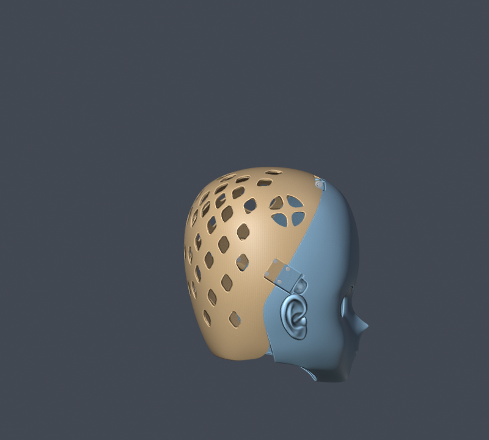
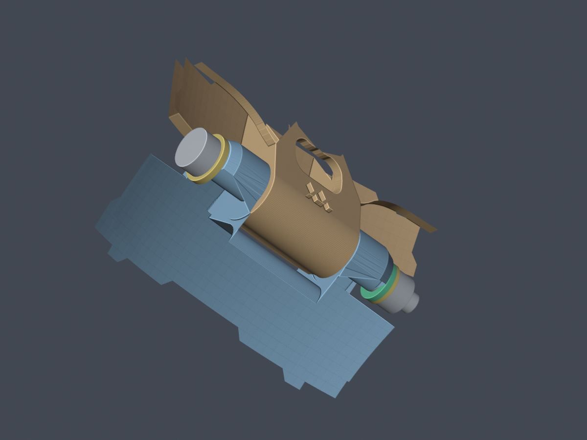
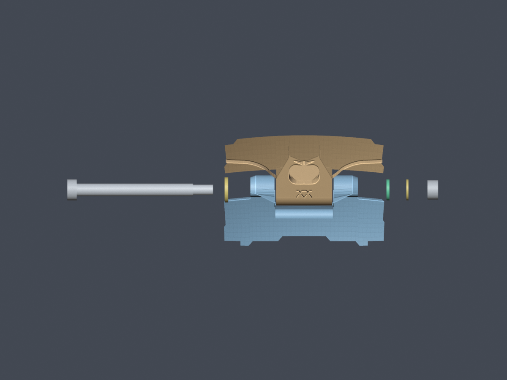
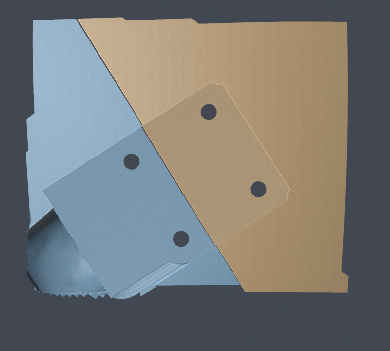
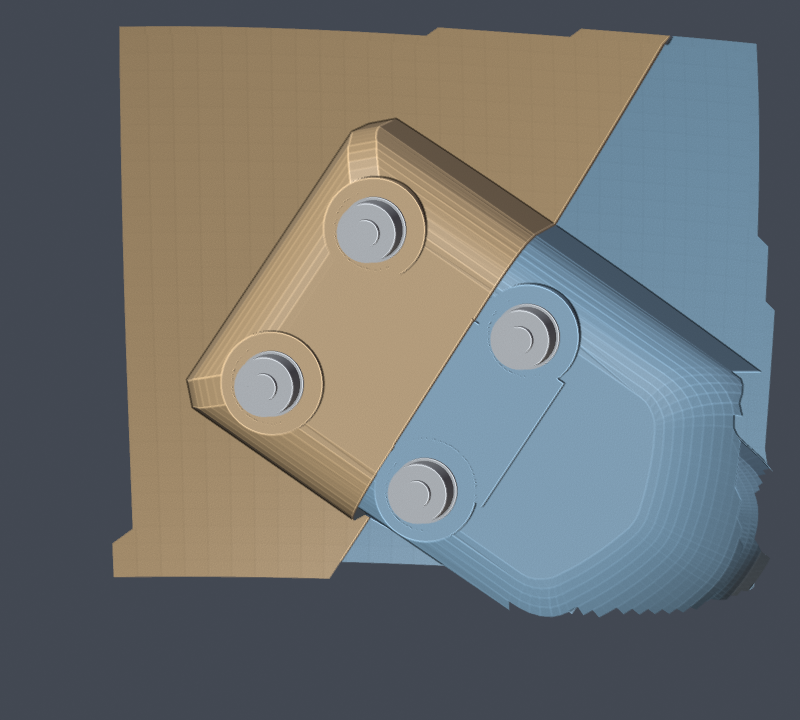

# Project Pulsar 使用手册

适用文件：`ProjectPulsar_Base.blend`  
验证环境：Blender 5.2.2 LTS  
更新日期：2026-10-21

本手册介绍从打开工程、调整参数到分别导出前后壳的日常流程。工程保留了几何节点、布尔结构和辅助对象，调整参数后会重新生成网格。

图中蓝灰色为前壳、棕色为后壳；眼部功能示例中的黑色为睫毛。这是手册的检查配色，不代表工程打开后的材质或打印颜色。当前 Base 隐藏黑色睫毛／眼线，保留眼睛上方的眉形开孔。

完整物料表见第 4.5 节，当前七份 STL 见第 7.5 节。五金参考对象只用于装配示意，不与壳体一起打印。



## 1. 第一次使用：先导出一套默认模型

1. 使用 Blender 5.2.2 LTS 打开仓库中的 `ProjectPulsar_Base.blend`。
2. 用「文件 → 另存为」保存工作副本，例如 `ProjectPulsar_Dev.blend`，保留 Base 作为对照。
3. 在大纲视图中找到 `前壳配置`，选中后打开右侧扳手图标的「修改器属性」，展开「几何节点」。
4. 确认前壳参数为：`是否布尔=开启`、`锁类型=1`、`前后基准值=0.78`、`锁深度位移=1.1`。
5. 选中 `后壳配置`，确认 `是否布尔=开启`、`圆角位置=0.037`。
6. 等待网格更新完成，检查外侧、内侧、顶部铰链及两侧锁结构。
7. 使用第 7.5 节本次导出的七份 STL，或按其中的验证与导出命令复现；整壳、垫套与试件分开打印。

正常打开和调参不需要运行仓库里的 Python 修复脚本，也不需要为了视孔生成改变头壳的平滑／平直着色。工程使用的字体已打包在 `.blend` 内。

## 2. 对象与集合：应该选哪个

通过大纲视图搜索对象名称，比在重叠的模型表面反复点击更准确。部分参数对象默认隐藏，仍可在大纲视图中定位；需要观察时临时显示即可。

| 对象 | 所在集合 | 日常用途 | 是否作为最终壳体导出 |
|---|---|---|---|
| `前壳配置` | 几何节点与结构 | 前壳、锁类型、分界位置、前壳文字 | 是 |
| `后壳配置` | 几何节点与结构 | 后壳、后壳文字、底部圆角缺口 | 是 |
| `Hinge_Spacer_1p4_PRINT` | Pulsar_Hinge_Hardware_Assembly | 顶部打印垫套，交付 STL 已平放 | 单独导出；优先使用交付文件 |
| 名称含 `REFERENCE` 或集合 `Pulsar_Side_Latch_Fasteners_REFERENCE` 内的对象 | 五金装配参考 | 采购五金的名义外形示意 | 不打印 |
| `r插销` | 原有集合 | 隐藏的旧版样件，不参与当前装配 | 不导出 |
| `头壳` | 实体 | 调整脸型、睁眼、腮部、张嘴 | 否，常规流程导出生成后的前后壳 |
| `视孔` | 实体 | 调整视孔生成、内外侧和左右位置 | 是切割辅助对象，通常不和壳体一起导出 |
| `睫毛` | 实体 | 眼部外观与样式选择 | 单独观察；打印眼线优先使用 `眼线配置` |
| `睫毛0_形变源` | 实体 | 默认睫毛的内部形变引用，通常隐藏 | 不单独导出 |
| `眼线配置` | 几何节点与结构 | 眼线布尔、刻字和独立导出 | 需要眼线零件时单独导出 |
| `头壳低面封闭`、`前壳布尔`、`后壳布尔`、`后壳打洞` 等 | 实体／用于节点的物体等 | 几何节点的引用与切割输入 | 不作为常规最终零件一起导出 |
| `预设`、`参考` 集合 | 预设／参考 | 上游保留的造型参考和素材 | 不批量导出 |

检查最终外观时，隐藏临时显示的参考头壳和切割体，保留需要观察的生成对象。两套表面叠在一起可能产生闪烁或黑块。

前后壳共享参数关系。常规使用建议每个文件保留一套配置，需要新变体时另存文件，不要直接复制出多套同名关系而忽略对象引用。

## 3. 调整脸型与眼部外观

### 3.1 捏脸

选中 `头壳`，在「几何节点」修改器中调整以下输入：

| 参数 | Base 默认值 | 当前界面范围 |
|---|---:|---:|
| 滑移脸型 | 0 | -0.5～1.5 |
| 睁眼大小 | 0 | -0.2～1 |
| 腮帮子 | 0 | -0.2～1 |
| 张嘴大小 | 0 | 0～1.2 |

一次调整一个参数，观察正面、侧面和内侧，再调整下一个。界面允许的范围不等于所有组合都已经通过打印或装配验证；修改头型后应检查自己的当前配置。

前后壳对象的底层网格是占位几何。日常捏脸从 `头壳` 的参数进入，不要把 `前壳配置` 或 `后壳配置` 当作已经应用修改器的普通网格直接编辑。

工程中部分节点按原始空间读取参考对象。仅在对象模式下缩放某一个参考头壳，可能使不同部件的尺寸关系失配。本手册以现有对象缩放和尺寸为基准；整体改尺寸、替换基础头型和重新绑定表面形变属于进一步建模操作。

### 3.2 睫毛样式

当前 Base 已关闭 `睫毛` 和 `眼线配置` 的视口显示及渲染显示。要恢复外观，在大纲视图中打开对应对象的眼睛图标；需要渲染时再打开相机图标。隐藏只影响显示，节点引用与可编辑参数保留。不要通过关闭 `视孔` 修改器来隐藏睫毛，这会改变壳体开孔。

选中 `睫毛`，修改「睫毛类型」：

| 值 | 使用的几何来源 |
|---:|---|
| 0 | 当前睫毛对象的基础几何，Base 默认 |
| 1 | `睫毛1` |
| 2 | `睫毛2` |

三种样式现在分别进行表面形变，再参与样式选择。切换后检查眼缘贴合、左右位置和修改器状态。`预设` 集合中的 `眼线1`～`眼线13` 并不是这里可直接输入的 13 个编号。

壳体参数矩阵使用 Base 默认头型和睫毛类型 0；另补充验证了三种样式在睁眼大小 0／0.3 时的形变和眼线输出。任意预设替换、基础网格编辑或大幅捏脸仍需检查自己的配置。

## 4. 前后壳、分界线与锁

### 4.1 前壳配置

| 参数 | Base 默认值 | 用法 |
|---|---:|---|
| 是否布尔 | 开启 | 导出最终零件前必须开启，并等待计算结束 |
| 锁类型 | 1 | `0=大锁`、`1=小锁`、`2=无锁` |
| 前后基准值 | 0.78 | 控制前后分界位置，界面及节点限制为 0～0.85 |
| 锁深度位移 | 1.1 | 调整锁相关结构的深度位置；建议先保留默认值 |
| 前壳文字 | `um_xx` | 修改前壳刻字内容，修改后检查内侧生成结果 |
| 头壳 | `头壳` | 对象引用，普通调参时保留 |

锁类型、前后基准值和锁深度通过前壳传递给后壳。要换锁或调整分界，先改前壳的参数，再一起检查前后壳；不需要分别修改两套锁源网格。

前后基准值越接近上限，分界与风扇孔的关系越需要仔细观察。0.85 是当前设计的限制，不建议通过改节点解除限制来继续拖动。

### 4.2 后壳配置

| 参数 | Base 默认值 | 用法 |
|---|---:|---|
| 是否布尔 | 开启 | 与前壳一起开启后检查最终结果 |
| 圆角位置 | 0.037 | 0 表示没有底部圆弧缺口；增大会扩大缺口 |
| 后壳文字 | `xx` | 修改后查看内侧刻字 |
| 头壳 | `头壳` | 保持引用 |
| 头壳布尔实体 | `头壳低面封闭` | 保持引用 |
| 后壳打洞 | `后壳打洞` | 保持引用 |

默认圆角适合先检查原设计的结构关系：


`圆角位置=0.1` 是本轮回归的边界样例，不是推荐的默认配置。它会明显抬高下缘，并切到低位通风孔和插扣附近，结构外形与默认状态不同：


这种较大圆角可能启用自动重建，计算量和输出面数会增加。等待更新完成后，再检查结构和导出。界面没有给圆角设置有限上限，本轮验证范围只覆盖到 0.1。

### 4.3 头顶转轴、配件与安装（铰链修订 2）

当前发布版使用 **Ø6 × 55 mm 光轴段、M5 尾牙的金属肩轴螺钉**。它贯穿前壳的两个外耳和后壳的中间轴套；左侧轴头与平垫圈、右侧垫套与防松螺母共同防止轴向退出。旧 `r插销` 已隐藏并标为 `legacy_unused`，保留作历史参考，本版不安装、不导出。这个方案不依靠 PLA 弹臂的变形止退。

左右以 Blender 世界 X 方向定义：轴头在 X 负侧，螺母在 X 正侧；安装时沿 **−X → +X** 推入。当前轴心为 **(−0.010565, 52.80887, 137.9162) mm**，轴线沿 X。前后壳保留现有整体形状和侧边金属搭扣安装座；原后壳刚性插舌在开合开始的几度内碰到前壳，因此已从最终输出移除。



**配件清单。** 下列每项各需一件；只有垫套需要打印。购买时核对全部尺寸，尤其是 **光轴直径 6.0 mm、光轴长度 55 mm**。不要仅按“M5 × 55 螺丝”搜索：普通全牙螺丝不等同于这里的肩轴，其他厂家的 ISO 7379 名称也可能对应 Ø6.5 mm 光轴。

| 配件 | 确定规格 | 获取方式 |
|---|---|---|
| 金属肩轴螺钉 | 光轴 Ø6 × 55；尾牙 M5 × 0.8、长 9.5；头部 Ø10 × 4.5；内六角 3 mm | 采购；尺寸实例 Ganter `ISO 7379-6-M5-55` |
| 轴头侧 M6 平垫圈 | 内径 6.4 × 外径 12 × 厚 1.6 mm | 采购金属件，DIN 125 / ISO 7089 对应尺寸 |
| 螺母侧垫套 | 内径 6.6 × 外径 10 × 厚 1.4 mm | 打印 `ProjectPulsar_Hinge_Spacer_1p4.stl` |
| 螺母侧 M5 平垫圈 | 内径 5.3 × 外径 10 × 厚 1.0 mm | 采购金属件 |
| M5 防松螺母 | M5 × 0.8，DIN 985，尼龙圈，对边 8、总高 5 mm | 采购金属螺母；不打印螺纹止退件 |

肩轴规格来自 [Ganter 尺寸表](https://live-katalog.ganternorm.com/pdf/ganter/EN/7379.pdf)，两种垫圈尺寸分别参照 [OBO M6 平垫圈](https://www.obo.de/de-de/produkte/unterlegscheibe-12-6-4-1-6-m6-3402061.html)和 [Mädler M5 平垫圈](https://www.maedler.de/Article/65315500)，螺母尺寸参照 [Accu DIN 985 M5](https://www.accu.co.uk/hexagon-nylon-locking-nuts/7947-HNN-M5-A2)。这些来源确认尺寸系列；没有购买或测量到货零件。

**配合与止退。** 两壳轴孔统一为 Ø6.6 mm，针对 Ø6 光轴的名义直径间隙为 0.6 mm。对求值网格的测量得到最小单边间隙约 0.300 mm；前后耳轴间每侧约 **0.728 mm**，整根轴在止退件之间的名义轴向活动余量约 **1.02 mm**。实际打印、垫圈厚度和肩轴长度公差会改变这些值，先用本节试打件确认。

M5 平垫圈的孔径 5.3 mm 小于光轴直径 6 mm，因此它抵住金属轴肩。防松螺母收紧在这只金属垫圈上，不能把塑料耳轴夹紧。左侧 M6 垫圈孔径大于光轴，位于轴头下方。两种垫圈不能互换。模型中的五金采用保守外包络；没有建模螺纹牙型，也没有模拟拧紧扭矩。

**装配顺序：**

1. 先打印本次导出的前、后铰链局部试件及 1.4 mm 垫套，用实际购买的五金验证。试件保留真实孔、耳轴和壳体根部，只在外围裁切成小块；它们不代替整壳。
2. 清理孔口和支撑毛刺，将后壳中间轴套放入前壳两耳之间，使三段孔同轴。开合时前壳固定，后壳向后上方翻开。
3. 把 **M6 平垫圈先套到肩轴上**，推到轴头下方。由轴头侧（−X）沿左侧让位通道，将轴依次穿过前壳左耳、后壳中间轴套、前壳右耳。轴应能手推通过，不应靠敲打装入。
4. 在 +X 侧从头壳内部拿入小件，在轴端外侧约 X=45 mm 的空间对准，然后沿轴套入：**1.4 mm 打印垫套 → M5 平垫圈 → M5 防松螺母**。模型已检查这段轴向装入空间。
5. 用 3 mm 内六角固定轴头，8 mm 扳手或外径不超过 12 mm 的小型套筒拧上螺母。检查螺纹穿过尼龙圈；按名义尺寸，螺母外还余约 3.5 mm 螺纹。到 M5 平垫圈抵住金属轴肩即可，不继续用力压塑料。
6. 确认两耳之间仍有间隙，后壳能轻松转动，转轴只有少量轴向活动。若出现夹死、孔紧或明显晃动，先测量试件和实际五金，再调整垫套厚度或打印孔补偿；不要强行磨薄耳轴。
7. 实物首次检查范围为 **闭合至 75°**。数字模型已扫描到 80°，保留 5° 操作余量。80° 不是机械硬限位；本版没有增加开角锁止机构，不继续强掰至 90°。
8. 拆卸时托住后壳，拆下防松螺母、M5 垫圈和垫套，再沿 −X 抽出肩轴。开合前还要释放左右金属搭扣。



**数字验证的范围。** [装配检查记录](top-hinge-validation-2026-10-21.json)包含完整两壳及五金外包络在 **0–80°、每 0.25° 共 321 个姿态**的表面穿插和连通体包含检查；另在 0°、40°、75°、80°做独立实体求交，并检查插入通道、工具空间和止退件不能直接越过耳轴。过粗轴、反向开合和止退件轴向逃逸作为应当碰撞的对照。离散检查没有宣称连续碰撞证明，也不能代替实际打印装配、磨损、疲劳和承载试验。


本节机械装配验证针对当前默认头型、`锁类型=1`、`前后基准值=0.78`、`圆角位置=0.037`。孔位切割继续跟随参数化铰链基准点；五金示意对象保存在默认装配位置。修改头型或分界参数后，不能沿用本次装配结论或五金示意位置。61 场景拓扑回归只检查网格与导出，不是 61 种配置的运动学验收。

**侧边锁座的状态。** 本版同时将两侧安装座改为 20 × 20 mm 孔距的 M3 螺丝固定，详见下一节与物料表。此前关于旧 `r插销` 的几何检查保留在[历史记录](closure-inspection-2026-10-21.json)，不作为本版装配依据。

### 4.4 两侧 40 × 27 mm 带锁搭扣：螺丝固定

本版按用户提供的第三张商品图改造两侧安装座：**40 × 27 × 12.5 mm 带钥匙锁的四方搭扣，孔距 20 × 20 mm、金属孔径 Ø3.5 mm、底板厚 0.5 mm**。采购两只。此前 48 × 31 mm 无锁款、40 × 27 mm 无锁款的孔距不同，不作为本版适配目标。

四根实心定位柱已去除，每侧改成四个 **Ø3.5 mm 真通孔**。孔周为 **Ø11 mm、厚 4 mm 的加强承压区**，背面有 **Ø8.6 mm** 垫圈／螺母与小套筒让位，外侧安装让位区为 **40.6 × 27.6 mm**。两侧共 8 个螺栓固定点，其中每侧前壳两个、后壳两个。

**中心不再开锁芯让位孔。** 根据本轮修订，两侧原 Ø10 mm 开孔均补回实体；在前壳两个螺丝承压区之间设置 **12 × 16 mm、厚 4 mm** 的实体连接区，与安装座合为一体，避免大孔削弱中间连接。每侧只保留四个 Ø3.5 mm 螺丝通孔。数字检查另对原孔覆盖范围逐点测量，确认中心连续实心和承托厚度；这不是材料承载或疲劳试验。商品图没有提供完整背面凸起、锁盖内侧及活动轮廓，商品五金的贴合和开锁动作仍需用实物与侧锁试打件确认。



每个固定点的顺序是：**M3 低圆头螺丝 → 金属搭扣底板 → 4 mm 塑料承压区 → M3 金属平垫圈 → M3 防松螺母**。使用 ISO 7380-1 M3 × 10 螺丝，头部最大 Ø5.7 × 1.65 mm，2 mm 内六角；不要换成头径更大的带法兰款。后侧使用内径 3.2 × 外径 7 × 厚 0.5 mm 的金属平垫圈，以及对边 5.5、总高 4 mm 的 DIN 985 M3 尼龙圈防松螺母。用于后侧孔内的 5.5 mm 薄壁套筒外径应不超过 8 mm。两侧各 4 套，总计 8 套。

按名义尺寸，夹持栈为 0.5 mm 金属底板 + 4 mm 塑料 + 0.5 mm 垫圈 + 4 mm 螺母，共 9 mm；M3 × 10 的螺纹会在螺母外露出约 1 mm。实际安装应看到螺纹穿过尼龙圈。将螺丝拧到五金压稳即可，避免继续挤压 PLA；不要把螺丝直接旋进塑料孔当作自攻固定。

螺丝尺寸参照 [Accu ISO 7380-1 M3 × 10](https://www.accu.co.uk/socket-button-screws/795782-SSB-M3-10-A4-ALK)，垫圈参照 [Mädler M3 平垫圈](https://www.maedler.de/Article/65315300)，螺母参照 [Accu DIN 985 M3](https://www.accu.co.uk/hexagon-nylon-locking-nuts/7944-HNN-M3-A2)。螺丝链接用于核对几何尺寸，不要求购买预涂锁紧胶版本；本方案使用防松螺母。

装配时先让头壳完全闭合，把搭扣两半分别放在前、后壳上，四个孔应自然对齐。先装上全部螺丝并轻拧，再交替均匀收紧。打开搭扣，确认四个螺丝头不顶住活动盖，锁芯尾部不顶住壳体，再验证头壳开合。左右搭扣必须都释放后，后壳才能绕顶部轴翻开。



[侧锁验证记录](side-latch-validation-2026-10-21.json)逐个测量了 8 个孔的通透、实际截面、4 mm 承压厚度和两组 20 × 20 mm 孔距，并检查两侧原 Ø10 mm 孔范围内的实体承托（每侧 81 点，实测约 4.00–4.05 mm）。整壳开合检查同时包含 32 个侧锁螺丝、头部、垫圈和螺母外包络；释放后的商品搭扣活动盖没有 CAD 数据，未纳入运动学检查。旧实心柱尺寸保存在[改造前测量记录](side-lock-dimensions-2026-10-21.json)，不再作为本版钻孔依据。

### 4.5 整套装配物料表

下表对应一套头壳。五金数量不含备件；前后壳与垫套用已确定的拓竹 H2S、0.4 mm 喷嘴、PLA 打印。旧 `r插销` 不在物料表中。

| 类别 | 物料 | 规格 | 数量 |
|---|---|---|---:|
| 打印 | 前壳 | `ProjectPulsar_Front_Closure_v4.stl` | 1 |
| 打印 | 后壳 | `ProjectPulsar_Rear_Closure_v4.stl` | 1 |
| 打印 | 顶部轴向垫套 | Ø6.6 内孔 × Ø10 外径 × 1.4 mm 厚 | 1 |
| 采购 | 顶部金属肩轴 | Ø6 × 55 mm 光轴，M5 × 0.8 尾牙长 9.5 mm；例 Ganter `ISO 7379-6-M5-55` | 1 |
| 采购 | 顶部轴头侧平垫圈 | M6，6.4 × 12 × 1.6 mm，金属 | 1 |
| 采购 | 顶部螺母侧平垫圈 | M5，5.3 × 10 × 1.0 mm，金属 | 1 |
| 采购 | 顶部防松螺母 | DIN 985 M5 × 0.8，尼龙圈，对边 8 mm | 1 |
| 采购 | 带钥匙锁四方搭扣 | 40 × 27 × 12.5 mm，孔距 20 × 20 mm，孔 Ø3.5，底板厚 0.5 mm，钥匙随锁配套 | 2 |
| 采购 | 侧锁低圆头螺丝 | ISO 7380-1 M3 × 10，螺距 0.5，头 Ø5.7 × 1.65 mm；无额外法兰 | 8 |
| 采购 | 侧锁平垫圈 | M3，3.2 × 7 × 0.5 mm，金属 | 8 |
| 采购 | 侧锁防松螺母 | DIN 985 M3 × 0.5，尼龙圈，对边 5.5、高 4 mm | 8 |
| 试打 | 顶部铰链前、后局部试件 | `ProjectPulsar_Hinge_Test_Front.stl`、`ProjectPulsar_Hinge_Test_Rear.stl` | 各 1 |
| 试打 | 左侧搭扣前、后局部试件 | `ProjectPulsar_SideLatch_Test_Front_L.stl`、`ProjectPulsar_SideLatch_Test_Rear_L.stl`；两侧孔型镜像相同 | 各 1 |
| 工具 | 内六角与扳手／套筒 | 3 mm、2 mm 内六角；8 mm 小套筒外径 ≤12 mm、5.5 mm 薄壁套筒外径 ≤8 mm | 各 1 |

顶部转轴使用 M6 与 M5 两种不同垫圈，按第 4.3 节区分位置。全部螺纹件用金属件，PLA 打印的是壳体和垫套。耗材用量、打印时间和支撑量以最终切片统计为准，本次没有生成 G-code。

## 5. 生成视孔

1. 在「实体」集合中选中 `视孔`。
2. 打开其「几何节点」修改器。
3. 开启「生成」，先保持「反向」关闭、瞳距为 `6.03`。
4. 等待前壳重新计算，观察眼缘、睫毛附近及前壳内侧。
5. 如需使用另一侧的来源面，切换「反向」后重新检查。

| 输入 | 含义 |
|---|---|
| 生成 | 根据当前头壳表面生成视孔几何；默认关闭 |
| 反向关闭 | 使用头壳内侧面 |
| 反向开启 | 使用头壳外侧面 |
| 瞳距 | 控制左右位置的参数；默认 6.03，本轮测试值为 5.5、6.03、7.0 |

瞳距输入不是“已经与佩戴者视线对齐”的证明。它参与几何位置计算，实际位置还受头型和曲面相交结果影响。


新版使用显式来源面标记，已经不依赖 `sharp_face`。无需把头壳改成平直着色来修复空结果。切割体 `视孔` 通常不和前后壳一起交给切片软件。

## 6. 眼线布尔、刻字与独立导出

选中 `眼线配置`，展开「几何节点」修改器：

1. 开启「是否布尔」，观察生成的眼线零件。
2. 需要文字时，再开启「是否刻字」并修改「眼线文字」。
3. 检查文字是否完整、是否位于预期表面；必要时小步调整文字旋转和位置。
4. 只选中 `眼线配置`，按下一节的选中项导出规则单独导出。

Base 保存的数值如下：

| 输入 | 默认值 |
|---|---|
| 是否布尔 | 关闭 |
| 是否刻字 | 关闭 |
| 眼线文字 | `xx` |
| 文字旋转 | `(74.7, -30.85, 50.15)` |
| 文字位置 | `(0.53, 0.63, 0.61)` |

旋转和位置是原节点接口的三分量参数，不要直接把位置数值理解成毫米。先从默认设置开始逐轴调整。

本轮验证覆盖默认文字的布尔和刻字开关。换成长文字、其他字符或大幅调整文字位置后，应重新检查自己的输出。正常使用不需要从系统字体目录重新安装工程已打包的 HarmonyOS Sans SC Bold。

## 7. 分别导出 STL

### 7.1 导出前壳

1. 确认前壳和后壳的「是否布尔」都已开启，网格计算完成。
2. 清除其他对象的选择，只选中 `前壳配置`。
3. 使用「文件 → 导出 → STL」。
4. 设置以下选项：

| 导出项 | 本工程的设置 |
|---|---|
| Selection Only／仅选中项 | 开启 |
| Apply Modifiers／应用修改器 | 开启 |
| Properties／属性求值方式 | Viewport／视口，与本轮验证一致 |
| Scale／缩放 | **1000** |
| Scene Unit／场景单位 | 本手册流程关闭；保持工程 Unit Scale 为 1 |
| Up／向上轴 | Z |
| 文件格式 | 二进制 STL 即可 |

5. 保存为独立文件，例如 `Pulsar_Front.stl`。

### 7.2 导出后壳

只选中 `后壳配置`，使用相同设置，保存为 `Pulsar_Rear.stl`。需要眼线时另导出 `眼线配置`。

前后壳是两件装配零件。不要将两壳、参考头壳、切割体和其他辅助对象一起合成一个 STL；这会把接触、重叠或辅助几何带进切片软件。

STL 不携带可靠的长度单位约定。本工程内部按米计算，界面可以显示厘米，因此导出乘以 1000，将数值转换成毫米。这个 1000 是单位转换，不是把设计尺寸放大 1000 倍。

### 7.3 在切片软件里核对尺寸

默认配置的 X × Y × Z 包围盒约为：

| 零件 | 毫米 |
|---|---|
| 前壳 | **252.95 × 162.16 × 270.85** |
| 后壳 | **236.55 × 177.40 × 248.53** |

如果前壳只有约 0.253 mm 宽，通常漏掉了导出缩放；如果宽度到了约 252,945 mm，则可能重复放大。修改头型或结构参数后，尺寸会相应改变，不能继续拿默认尺寸作为唯一判断标准。

检查切片层预览中的孔、锁、铰链及薄片位置。数字网格通过不替代具体材料、支撑方向、打印设置和实物装配试验；本仓库没有提供已经实物验收的通用支撑预设。

### 7.4 为 3D 打印优化

已确定使用 **拓竹 H2S、0.4 mm 喷嘴、PLA**。官方成型空间为 **340 × 320 × 340 mm**；前后壳按现有方向、原尺寸分别打印时，即使在 X/Y 每侧预留 8 mm brim，两者的包围盒也各自能放入名义成型空间，因此不需要为了平台尺寸缩小或进一步切开。支撑的实际占用仍须在切片预览中确认。设备规格见 [H2S 官方页面](https://us.store.bambulab.com/en/products/h2s)，尺寸核算和官方预设快照见[H2S 配置依据](h2s-pla-profile-reference-2026-10-21.json)。

先按第 4.3 节准备五金，打印本次提供的前、后铰链局部试件及垫套，验证孔隙、轴向余量和 0–75° 开合后，再分别打印整壳。局部试件保持与整壳相同的轴向；若最终改变整壳打印方向，需要用相应方向重新试打配合。当前环境未安装 Bambu Studio，未生成或运行这套设备的切片／G-code，也没有实物验证结果。

**H2S 在 Bambu Studio 中的设置。**

| 项目 | 前壳 | 后壳 | 1.4 mm 垫套 |
|---|---|---|---|
| 设备 | `Bambu Lab H2S 0.4 nozzle` | 同左 | 同左 |
| 起始工艺预设 | `0.16mm High Quality @BBL H2S` | `0.20mm Standard @BBL H2S` | `0.20mm Standard @BBL H2S` |
| 层高／首层 | 0.16 / 0.20 mm | 0.20 / 0.20 mm | 0.20 / 0.20 mm |
| 建议墙层 | 3 | 3 | 4；检查薄环形成连续路径 |
| 建议填充 | 15% | 15% | 100%，实测打印厚度和孔径 |
| 外墙速度起点 | 保留 HQ 的 60 mm/s | 先降至 60～80 mm/s，观察曲面质量 | 先用 40 mm/s；其余小层冷却按 PLA 配置 |
| 建议 brim | 8 mm | 8 mm | 需要时 3 mm 外 brim，保持内孔畅通 |
| 摆放候选 | 以现有 Z 向上竖放开始，比较小幅倾斜后支撑是否更好拆 | 以现有 Z 向上竖放开始 | STL 已平放，厚度 1.4 mm 沿 Z，无需旋转 |

表中的墙层、填充、后壳／垫套速度和 brim 是本项目的建议修改值。官方 HQ 预设外墙为 60 mm/s，而 0.20 mm Standard 的外墙速度明显更高；不要把表中的候选设置当作厂商原始预设或已经验证的最佳值。已核对的预设名称和继承值来自 [Bambu Studio 官方仓库](https://github.com/bambulab/BambuStudio/tree/79df7ae309be398ed30c9f397c13c9911c2edc57/resources/profiles/BBL)。

PLA 品牌尚未指定时，先选 `Generic PLA @BBL H2S`。本次核对的该预设为喷嘴 220°C、纹理 PEI 板 55°C、最大体积流量 12 mm³/s、腔温目标 0（不主动加热）。这些值只描述这个官方预设，仍需匹配实际耗材和所用板材；若使用拓竹 PLA Basic、Matte 或其他已知耗材，应选匹配的耗材预设。保留对应的冷却与排风控制，不把 H2S 的最高机器速度直接当作普通 PLA 的可用速度。

支撑从树状自动支撑开始检查，再用绘制支持／屏蔽调整眼孔、鼻部、耳根、铰链和锁座。优先把接触放在内侧可拆除处，保留卡槽和配合面。使用同种 PLA 支撑时，先保留预设的顶部 Z 间距：0.16 mm HQ 为 0.16 mm，0.20 mm Standard 为 0.20 mm；不要设为 0，拆除困难时通过小试片调整。

旧 `r插销` 不再用于本版。肩轴、两只平垫圈和防松螺母使用金属件。局部铰链试件可从 0.20 mm 层高、4 圈墙、30% 填充开始，最终仍以切片路径为准；去除孔内支撑和毛刺后，用实物肩轴检查，保留孔内可拆支撑空间。

**先确定尺寸与装配，再调整细节质量。**

1. 将前后壳分别作为独立对象导入切片软件，按毫米、100% 缩放检查上述尺寸。导出的坐标保留设计坐标系，允许切片软件分别居中并落到平台上。
2. 在 H2S 的 340 × 320 × 340 mm 空间中分别居中、落到平台，给裙边和支撑留空间。前壳当前方向高度约 271 mm，可以保持原尺寸；如果以后换到更小的设备，再重新核对旋转或分件方案。
3. 不要为了塞进打印平台而随意缩小头壳。缩放会一起改变头围空间、孔径、壁厚、锁和铰链。需要分件时，尽量把新拼缝放在侧面／后方，避开脸部中心、锁座和铰链；增加定位及粘接面，并重新检查封闭性。
4. 先试打一个包含前后配合面的锁／铰链局部，再决定是否打印整壳。模型中的设计间隙应先保留；根据实物调整孔径、间隙或象脚补偿，不要把某个通用间隙数值直接覆盖所有结构。打印方向、材料和设备校准都会影响配合。[Prusa 的建模指南](https://help.prusa3d.com/article/modeling-with-3d-printing-in-mind_164135)也将公差试打和打印方向作为设计迭代的一部分。

**FDM 的通用调整原则。**

第一次验证头型和装配可先用 PLA 做局部试片，通常容易打印且翘曲较小；成品若更重视韧性、卡扣反复使用和温度适应，可评估 PETG，但它的拉丝、悬垂和支撑拆除也需要调试。这是根据材料特性做的选择建议，不能替代所购耗材的数据及实物测试。参考官方 [PLA](https://help.prusa3d.com/article/pla_2062) 和 [PETG](https://help.prusa3d.com/article/petg_2059) 材料说明。

| 项目 | 首轮试片／切片比较的起点 |
|---|---|
| 层高 | 普通区域 0.20 mm；重视脸部曲面时比较 0.16 mm 或局部可变层高 |
| 墙层 | 从 3 圈起，逐层确认内外轮廓连续；不要直接把“圈数 × 线宽”当作真实壁厚 |
| 稀疏填充 | 从 10%～15% 起，观察较厚连接部位；薄壳本身通常主要由墙线和实心层构成 |
| 局部强度 | 优先检查耳根、锁座、铰链根部及眼孔周围；需要时使用局部更多墙线或结构加筋 |
| 支撑 | 比较竖放和适度倾斜的方案，尽量把接触点放在内侧或后续易打磨处；脸部外表面优先避开支撑 |
| 接缝 | 尽量安排在后侧、分界附近或内侧可接受位置；不要让随机接缝散布脸部 |
| 平台附着 | 接触面积小或边缘易翘时评估 brim；同时给支撑底部留空间 |
| 温度、速度、冷却 | 以实际打印机及该材料的官方配置为起点，先校准再调整；此处不指定通用温度或高速参数 |

这是已有内外壁的中空壳体。主壳 Solidify 的名义厚度为 **2.62 mm**，耳部名义厚度为 **2 mm**；曲面、布尔切口和局部结构使实际厚度不恒定。这些数值不能当作全模型的最小壁厚认证。不要为了提高强度就整体大幅加厚，也不要用花瓶模式切片；先看锁、铰链和耳根是否有足够连续的材料路径。局部加筋或内侧圆角也必须避免侵入配合面。

降低层高主要改善 Z 方向台阶，不会自动修复 XY 细节；壁线宽度、重叠和可变线宽会影响实际墙线排布。切片预览比简单相乘更可靠。[Prusa 的层与轮廓说明](https://help.prusa3d.com/article/layers-and-perimeters_1748)解释了这些关系。

**树脂打印需要额外处理耳内空腔。**

当前前壳含四个封闭耳内空腔。树脂方案应逐个确认排液、通气、清洗和固化通路：在合适位置连通空腔或填实过小的空腔，并结合实际摆放避免吸盘效应。排液孔尺寸按具体打印机、树脂和清洗条件确定，不能因为 STL 封闭就直接判定可打印。这与 [Formlabs 的空腔与吸盘说明](https://formlabs.com/support/Preventing-suction-cups-in-PreForm/)及[摆放、排液指南](https://formlabs.com/blog/how-to-orient-sla-parts/)一致。

**最后检查实际切片，而不只看三维外观。**

逐层确认所有零件的起始层有支撑，孔和槽未消失，耳内没有无法取出的 FDM 支撑，锁舌与铰链的受力方向合理，前后接缝没有被自动修复意外封住。完成局部试打和装配确认后，再打印整壳。这里尚未生成针对具体设备的 G-code，也没有实物装配结果。

### 7.5 本次 STL 交付与复现

当前交付目录为 **`exports/2026-10-21-closure-v4/`**。这次修改了两壳的顶部孔、轴向间隙、左侧装入通道，移除妨碍开合的后壳刚性插舌，并将两侧搭扣改为 M3 穿孔固定。本轮再取消两侧中心 Ø10 mm 让位孔，补回 4 mm 厚实体连接区。旧目录 `exports/2026-10-21/`、`exports/2026-10-21-closure-v3/` 属于历史版本，不与本版混用；旧 `ProjectPulsar_R_Pin.stl` 不装配。

仍使用默认小锁配置：`锁类型=1`、`前后基准值=0.78`、`圆角位置=0.037`、`视孔生成=关闭`；黑色睫毛／眼线隐藏，眉形开孔保留。

| 文件 | 用途 | 三角形数量 |
|---|---|---:|
| `ProjectPulsar_Front_Closure_v4.stl` | 前壳，打印 1 件 | 521,844 |
| `ProjectPulsar_Rear_Closure_v4.stl` | 后壳，打印 1 件 | 134,282 |
| `ProjectPulsar_Hinge_Spacer_1p4.stl` | 1.4 mm 垫套，打印 1 件；已平放 | 1,024 |
| `ProjectPulsar_Hinge_Test_Front.stl` | 顶部前壳局部试件 | 4,430 |
| `ProjectPulsar_Hinge_Test_Rear.stl` | 顶部后壳局部试件 | 4,768 |
| `ProjectPulsar_SideLatch_Test_Front_L.stl` | 左侧搭扣前壳局部试件 | 11,414 |
| `ProjectPulsar_SideLatch_Test_Rear_L.stl` | 左侧搭扣后壳局部试件 | 7,584 |

七个 STL 均通过导出回读的开放边、多面共边、绕序、重复面和退化面检查；单位为 mm。文件尺寸、SHA-256、打印坐标变换和源工程 SHA 见[当前导出清单](top-hinge-stl-manifest-2026-10-21.json)。前后壳各打印一件，垫套打印一件；另外四件是先行试打件。STL 按仓库惯例保留在本地，未纳入 Git。

可按下列顺序复现验证和导出，三个命令都不改写工程。导出器要求装配检查通过，且检查记录中的 SHA 与打开的工程完全相同：

```sh
"/Applications/Blender.app/Contents/MacOS/Blender" \
  --background --factory-startup --disable-autoexec --python-exit-code 1 \
  ProjectPulsar_Base.blend --python tools/validate_top_hinge.py -- \
  --output /tmp/pulsar-hinge-validation.json

"/Applications/Blender.app/Contents/MacOS/Blender" \
  --background --factory-startup --disable-autoexec --python-exit-code 1 \
  ProjectPulsar_Base.blend --python tools/validate_side_latches.py -- \
  --output /tmp/pulsar-side-latch-validation.json

"/Applications/Blender.app/Contents/MacOS/Blender" \
  --background --factory-startup --disable-autoexec --python-exit-code 1 \
  ProjectPulsar_Base.blend --python tools/export_top_hinge.py -- \
  --validation /tmp/pulsar-hinge-validation.json \
  --side-validation /tmp/pulsar-side-latch-validation.json \
  --exports exports/2026-10-21-closure-v4 \
  --manifest /tmp/pulsar-hinge-stl-manifest.json
```

肩轴修复脚本 `tools/repair_top_hinge.py` 用于从修复前版本重放改造，要求明确指定输出，并拒绝重复添加节点。日常打印使用 Base，不再次运行修复脚本。

## 8. 检查自己的当前配置

先保存工作副本，确保前后壳的「是否布尔」均已开启。在仓库根目录运行：

```sh
"/Applications/Blender.app/Contents/MacOS/Blender" \
  --background --factory-startup --disable-autoexec --python-exit-code 1 \
  ProjectPulsar_Dev.blend --python tools/validate_model.py -- \
  --current --output /tmp/pulsar-current.json --exports /tmp/pulsar-current-stl
```

上例适用于 macOS 终端。Linux 替换 Blender 可执行文件路径；Windows 还需将命令合为一行或改用 PowerShell 换行方式，并把 `/tmp/...` 换成可写目录。文件名含空格时加引号。

`--current` 保留保存的参数，检查前后壳以及已开启的视孔／眼线对象。它不会保存工程。使用 `--exports` 时还会生成独立 STL；其中视孔是辅助切割体，不要误当作需要打印的壳体零件。

| 运行方式 | 用途 |
|---|---|
| `--current` | 检查自己保存的实际参数，不重置参数 |
| 不传 `--current` 或 `--matrix` | 临时切换参数，运行 16 个重点回归场景 |
| `--matrix` | 临时切换参数，运行完整 61 个回归场景 |

`--current` 和 `--matrix` 不能同时使用。完整回归覆盖的是规定的参数网格，不意味着其间所有连续值、所有头型或所有刻字都已经检查过。

检查依据是导出后的 float32 毫米坐标，不只看 Blender 的顶点编号。脚本会报告开放边、多面共边、法线绕序、重复三角形、退化三角形、游离边和孤立顶点。`PASS` 表示这些数字网格检查通过；失败时查看 JSON 中对应对象的 `errors`。

近零面积另行记录：小于 `1e-8 mm²` 为近零面积，不大于 `1e-12 mm²` 判为退化。最小壁厚、承载能力和佩戴适配不是这个脚本的验收项目。

## 9. 常见问题

| 现象 | 先检查什么 |
|---|---|
| 找不到想改的参数 | 是否选中了表中对应对象；是否展开「几何节点」修改器 |
| 只看到占位方块，或导出了方块 | 修改器是否启用；导出是否勾选 Apply Modifiers |
| 原始头壳和成品壳体叠在一起闪烁 | 隐藏临时显示的参考对象，只观察需要的生成对象 |
| 视口出现斜长条阴影或黑块 | 先关闭视口着色的 Shadow，再排查重叠表面 |
| 调大圆角后更新明显变慢 | 可能触发自动重建；等待完成后再改下一项 |
| 两壳同时导出后切片软件报接缝问题 | 分别导出、分别导入，不混入辅助对象 |
| 切片软件识别到耳内独立壳 | 原设计有 4 个封闭耳内空腔，不要直接批量删除全部内部壳 |
| 视孔位置不合适 | 同时检查生成开关、反向、瞳距、头型及内外侧视图 |
| 换睫毛后贴合异常 | 恢复默认类型 0 对照，再检查表面形变与所用预设 |
| 新文字缺失或落在零件外 | 检查刻字开关、字体、文字长度、旋转和位置 |
| F12 提示没有相机 | 本工程的 STL 工作流不需要相机；查看模型使用视口即可 |
| 修复脚本提示工程已经修复 | 正常保护机制；日常使用无需再次运行修复脚本 |

## 10. 文件、验证记录与参考

- `ProjectPulsar_Base.blend`：仓库发布的基准工程。
- `ProjectPulsar_Dev.blend`：建议的本地工作副本名，已在 `.gitignore` 中。
- [README](../README.md)：快速说明、完整回归命令和修复重放命令。
- [修复历史](../Fix_History.md)：各轮修改的原因与范围。
- [当前完整场景验证](top-hinge-regression-2026-10-21.json)：铰链改造后的 61 场景拓扑回归。
- [当前装配验证](top-hinge-validation-2026-10-21.json)：开合扫描、配合尺寸、插入路径和止退对照。
- [当前 STL 清单](top-hinge-stl-manifest-2026-10-21.json)：七个打印文件的 SHA、单位、尺寸和回读结果。
- [肩轴改造重放记录](top-hinge-build-2026-10-21.json)：第一阶段的前后工程哈希与几何。
- [侧锁改造重放记录](side-latch-build-2026-10-21.json)：第二阶段的模板坐标、孔位、五金规格及最终工程哈希。
- [侧锁通孔验证](side-latch-validation-2026-10-21.json)：8 孔实测截面、孔距、承压厚度与螺丝间隙。
- [第五轮历史验证](validation-2026-10-21.json)：旧版 61 场景结果，不替代当前工程检查。
- [曲面距离记录](surface-comparison-2026-10-21.json)：默认和大圆角修复前后的逐顶点距离检查。
- [睫毛形变检查](eyelash-validation-2026-10-21.json)：三种样式的初始姿态与睁眼随动结果。
- [打印导出清单](stl-export-manifest-2026-10-21.json)：改造铰链前的历史交付文件。
- [独立插销验证](lock-pin-validation-2026-10-21.json)：补充插销的修复、导出及保存后检查，同时确认两壳保持不变。
- [H2S / PLA 配置依据](h2s-pla-profile-reference-2026-10-21.json)：官方预设版本、关键参数和两壳的平台包围盒核算。
- [闭合结构检查](closure-inspection-2026-10-21.json)：改造前的侧锁座、顶部铰链与旧插销检查。
- [侧锁尺寸与商品图比较](side-lock-dimensions-2026-10-21.json)：当前安装段尺寸、柱距，以及三款搭扣的读图尺寸。

参数名称、默认值和对象映射来自本工程。Blender 操作说明参考官方 [Geometry Nodes Modifier](https://docs.blender.org/manual/en/5.2/modeling/modifiers/geometry_nodes.html) 和 [STL 导入导出文档](https://docs.blender.org/manual/en/5.2/files/import_export/stl.html)。模型与字体的许可信息见仓库 [README](../README.md#许可) 和 [LICENSE](../LICENSE)。
