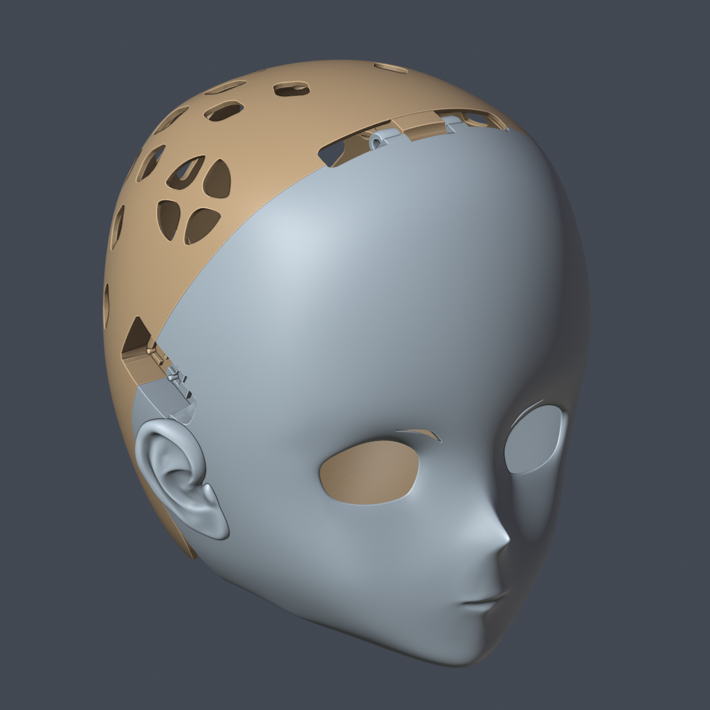
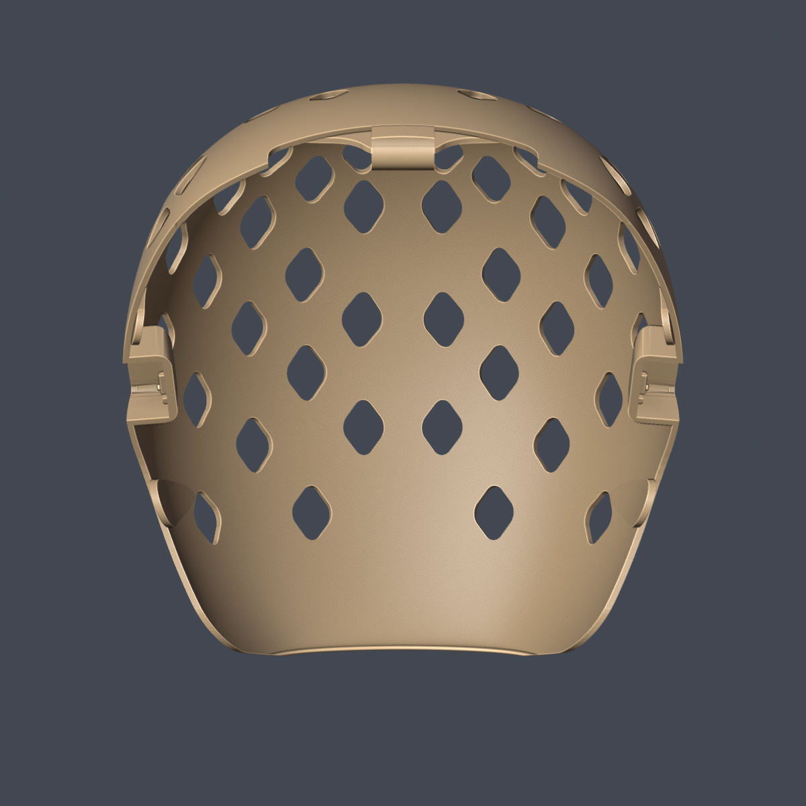
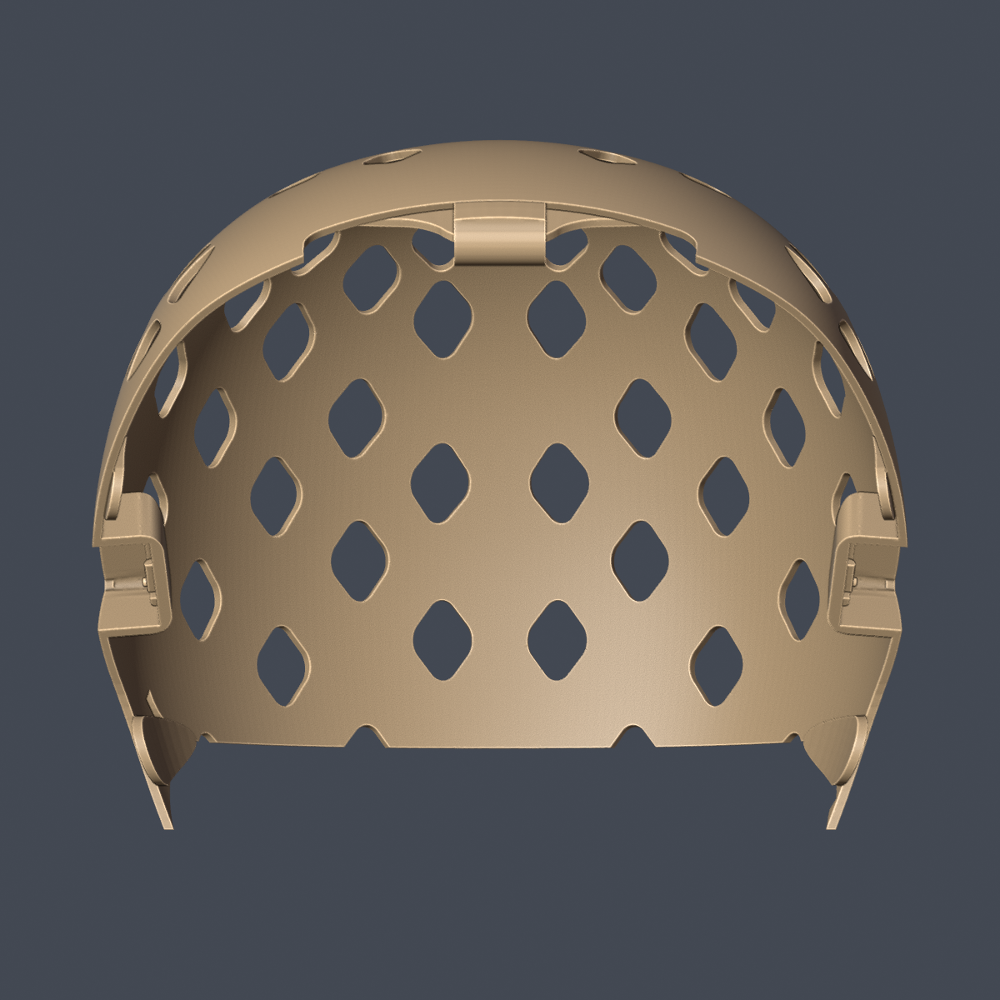
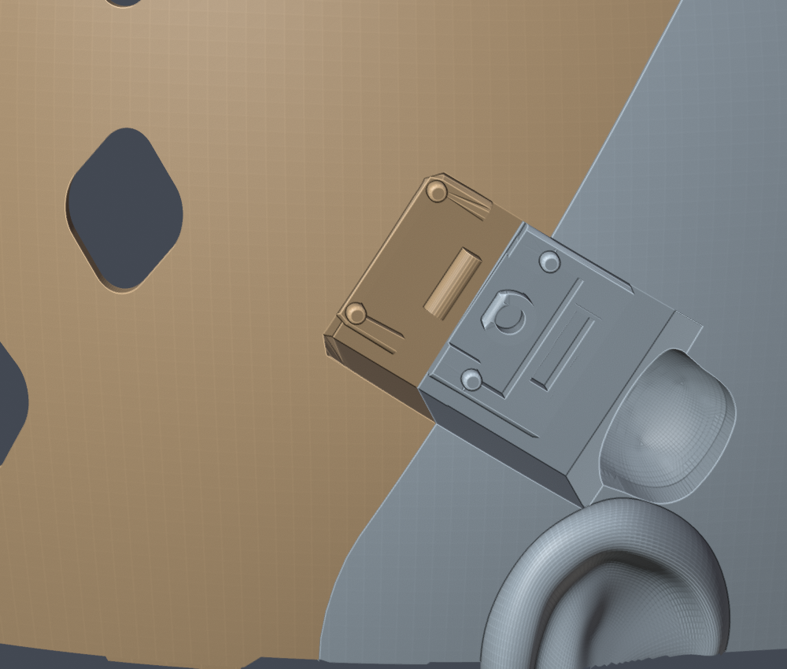
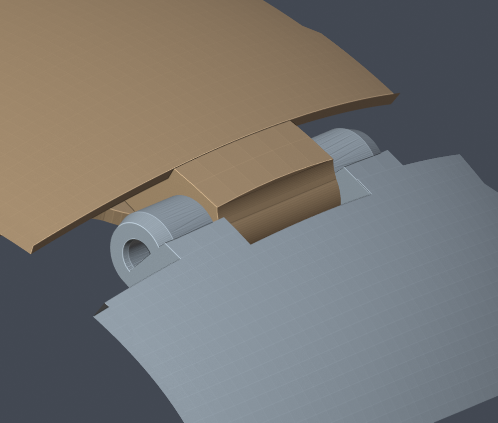
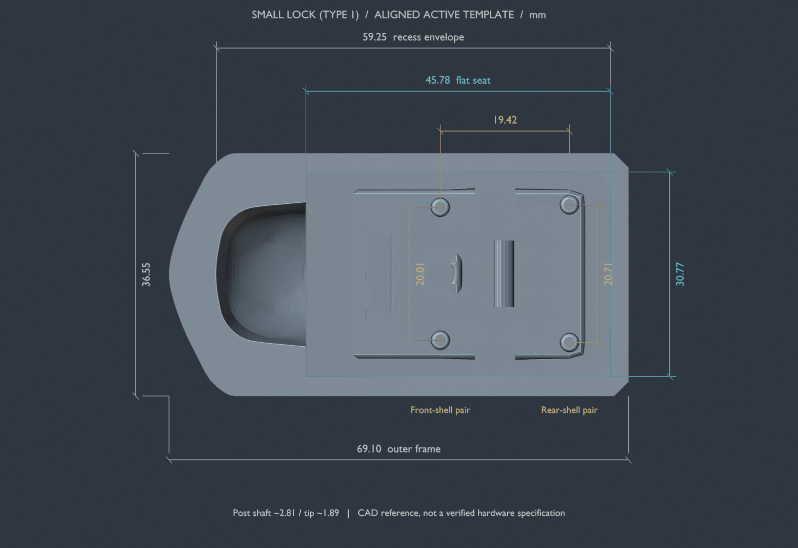
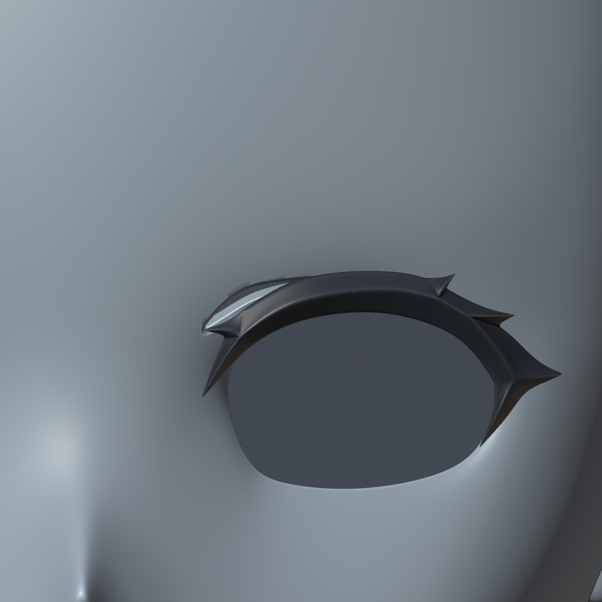

# Project Pulsar 使用手册

适用文件：`ProjectPulsar_Base.blend`  
验证环境：Blender 5.2.2 LTS  
更新日期：2026-10-21

本手册介绍从打开工程、调整参数到分别导出前后壳的日常流程。工程保留了几何节点、布尔结构和辅助对象，调整参数后会重新生成网格。

图中蓝灰色为前壳、棕色为后壳；眼部功能示例中的黑色为睫毛。这是手册的检查配色，不代表工程打开后的材质或打印颜色。当前 Base 隐藏黑色睫毛／眼线，保留眼睛上方的眉形开孔。



## 1. 第一次使用：先导出一套默认模型

1. 使用 Blender 5.2.2 LTS 打开仓库中的 `ProjectPulsar_Base.blend`。
2. 用「文件 → 另存为」保存工作副本，例如 `ProjectPulsar_Dev.blend`，保留 Base 作为对照。
3. 在大纲视图中找到 `前壳配置`，选中后打开右侧扳手图标的「修改器属性」，展开「几何节点」。
4. 确认前壳参数为：`是否布尔=开启`、`锁类型=1`、`前后基准值=0.78`、`锁深度位移=1.1`。
5. 选中 `后壳配置`，确认 `是否布尔=开启`、`圆角位置=0.037`。
6. 等待网格更新完成，检查外侧、内侧、顶部铰链及两侧锁结构。
7. 按[第 7 节](#7-分别导出-stl)分别导出两个 STL，核对尺寸。

正常打开和调参不需要运行仓库里的 Python 修复脚本，也不需要为了视孔生成改变头壳的平滑／平直着色。工程使用的字体已打包在 `.blend` 内。

## 2. 对象与集合：应该选哪个

通过大纲视图搜索对象名称，比在重叠的模型表面反复点击更准确。部分参数对象默认隐藏，仍可在大纲视图中定位；需要观察时临时显示即可。

| 对象 | 所在集合 | 日常用途 | 是否作为最终壳体导出 |
|---|---|---|---|
| `前壳配置` | 几何节点与结构 | 前壳、锁类型、分界位置、前壳文字 | 是 |
| `后壳配置` | 几何节点与结构 | 后壳、后壳文字、底部圆角缺口 | 是 |
| `头壳` | 实体 | 调整脸型、睁眼、腮部、张嘴 | 否，常规流程导出生成后的前后壳 |
| `视孔` | 实体 | 调整视孔生成、内外侧和左右位置 | 是切割辅助对象，通常不和壳体一起导出 |
| `睫毛` | 实体 | 眼部外观与样式选择 | 单独观察；打印眼线优先使用 `眼线配置` |
| `睫毛0_形变源` | 实体 | 默认睫毛的内部形变引用，通常隐藏 | 不单独导出 |
| `眼线配置` | 几何节点与结构 | 眼线布尔、刻字和独立导出 | 需要眼线零件时单独导出 |
| `头壳低面封闭`、`前壳布尔`、`后壳布尔`、`后壳打洞` 等 | 实体／用于节点的物体等 | 几何节点的引用与切割输入 | 不作为常规最终零件一起导出 |
| `预设`、`参考` 集合 | 预设／参考 | 上游保留的造型参考和素材 | 不批量导出 |

检查最终外观时，隐藏临时显示的参考头壳和切割体，保留需要观察的生成对象。两套表面叠在一起可能产生闪烁或黑块。

前后壳共享参数关系。常规使用建议每个文件保留一套配置，需要新变体时另存文件，不要直接复制出多套同名关系而忽略对象引用。

## 3. 调整脸型与眼部外观

### 3.1 捏脸

选中 `头壳`，在「几何节点」修改器中调整以下输入：

| 参数 | Base 默认值 | 当前界面范围 |
|---|---:|---:|
| 滑移脸型 | 0 | -0.5～1.5 |
| 睁眼大小 | 0 | -0.2～1 |
| 腮帮子 | 0 | -0.2～1 |
| 张嘴大小 | 0 | 0～1.2 |

一次调整一个参数，观察正面、侧面和内侧，再调整下一个。界面允许的范围不等于所有组合都已经通过打印或装配验证；修改头型后应检查自己的当前配置。

前后壳对象的底层网格是占位几何。日常捏脸从 `头壳` 的参数进入，不要把 `前壳配置` 或 `后壳配置` 当作已经应用修改器的普通网格直接编辑。

工程中部分节点按原始空间读取参考对象。仅在对象模式下缩放某一个参考头壳，可能使不同部件的尺寸关系失配。本手册以现有对象缩放和尺寸为基准；整体改尺寸、替换基础头型和重新绑定表面形变属于进一步建模操作。

### 3.2 睫毛样式

当前 Base 已关闭 `睫毛` 和 `眼线配置` 的视口显示及渲染显示。要恢复外观，在大纲视图中打开对应对象的眼睛图标；需要渲染时再打开相机图标。隐藏只影响显示，节点引用与可编辑参数保留。不要通过关闭 `视孔` 修改器来隐藏睫毛，这会改变壳体开孔。

选中 `睫毛`，修改「睫毛类型」：

| 值 | 使用的几何来源 |
|---:|---|
| 0 | 当前睫毛对象的基础几何，Base 默认 |
| 1 | `睫毛1` |
| 2 | `睫毛2` |

三种样式现在分别进行表面形变，再参与样式选择。切换后检查眼缘贴合、左右位置和修改器状态。`预设` 集合中的 `眼线1`～`眼线13` 并不是这里可直接输入的 13 个编号。

壳体参数矩阵使用 Base 默认头型和睫毛类型 0；另补充验证了三种样式在睁眼大小 0／0.3 时的形变和眼线输出。任意预设替换、基础网格编辑或大幅捏脸仍需检查自己的配置。

## 4. 前后壳、分界线与锁

### 4.1 前壳配置

| 参数 | Base 默认值 | 用法 |
|---|---:|---|
| 是否布尔 | 开启 | 导出最终零件前必须开启，并等待计算结束 |
| 锁类型 | 1 | `0=大锁`、`1=小锁`、`2=无锁` |
| 前后基准值 | 0.78 | 控制前后分界位置，界面及节点限制为 0～0.85 |
| 锁深度位移 | 1.1 | 调整锁相关结构的深度位置；建议先保留默认值 |
| 前壳文字 | `um_xx` | 修改前壳刻字内容，修改后检查内侧生成结果 |
| 头壳 | `头壳` | 对象引用，普通调参时保留 |

锁类型、前后基准值和锁深度通过前壳传递给后壳。要换锁或调整分界，先改前壳的参数，再一起检查前后壳；不需要分别修改两套锁源网格。

前后基准值越接近上限，分界与风扇孔的关系越需要仔细观察。0.85 是当前设计的限制，不建议通过改节点解除限制来继续拖动。

### 4.2 后壳配置

| 参数 | Base 默认值 | 用法 |
|---|---:|---|
| 是否布尔 | 开启 | 与前壳一起开启后检查最终结果 |
| 圆角位置 | 0.037 | 0 表示没有底部圆弧缺口；增大会扩大缺口 |
| 后壳文字 | `xx` | 修改后查看内侧刻字 |
| 头壳 | `头壳` | 保持引用 |
| 头壳布尔实体 | `头壳低面封闭` | 保持引用 |
| 后壳打洞 | `后壳打洞` | 保持引用 |

默认圆角适合先检查原设计的结构关系：



`圆角位置=0.1` 是本轮回归的边界样例，不是推荐的默认配置。它会明显抬高下缘，并切到低位通风孔和插扣附近，结构外形与默认状态不同：



这种较大圆角可能启用自动重建，计算量和输出面数会增加。等待更新完成后，再检查结构和导出。界面没有给圆角设置有限上限，本轮验证范围只覆盖到 0.1。

### 4.3 锁扣与独立插销

当前 `锁类型=1` 使用小锁结构。这里必须区分侧边锁座、顶部铰链和独立插销：导出了这些网格，并不代表闭合机构已经完成装配验证。之前将补导出 `r插销` 概括为“锁扣补齐”不够准确，以下以实际几何检查为准。

| 部件 | 所在输出 | 导出方式 |
|---|---|---|
| 前壳锁座及对应配合结构 | `ProjectPulsar_Front.stl` | 已与前壳布尔并集，一起打印 |
| 后壳锁座、侧边插扣的底座和舌片 | `ProjectPulsar_Rear.stl` | 已与后壳布尔并集，一起打印 |
| 顶部铰链的耳轴结构 | 前后壳 STL | 已随壳体打印；仍需确定轴与止退方案 |
| 独立 `r插销` | `ProjectPulsar_R_Pin.stl` | 已导出的独立样件；配合位置和装配方式尚未确认 |

`小锁结构`、`小锁布尔`、`插扣` 等隐藏源对象用于生成、定位和裁剪壳体附件，不应直接把这些未经最终裁剪的源网格当作装配零件导出。

**侧边结构是什么。** 左右两侧的小锁座跨越前后壳接缝，外侧有锁具轮廓、定位柱、槽和凹位。这些特征与壳体连成一体，当前没有单独的可活动锁舌、翻盖或转动锁芯。根据形状，它更像为成品小型搭扣／箱扣保留的安装座；这是几何推断，具体锁具型号和固定方式尚未确认，不能只凭“小锁”名称购买五金或认定两份壳体打印完就能锁闭。



**顶部结构是什么。** 前壳有两个外侧耳轴，后壳有中间连接段，轴线沿左右方向。当前前壳孔口的圆弧拟合直径约 5.70 mm，沿拟合轴线的射线可穿过两壳，但这不证明任意截面和长度的插销都能通过。轴向长度、截面余量、止退和开合运动需要单独验证。



**独立插销如何理解。** `r插销` 是一条直杆与弯曲弹臂相连的 R 形零件。按这种形状推断，直杆承担穿孔／连接，弯臂承担弹性止退；要拆出时需先解除弹臂的卡持，再沿插入轴退出。这是结构原理说明，不是本工程已经验证的安装步骤。

工程没有把 `r插销` 放在任何装配位置，没有父子约束或节点引用，也没有给出配合对象、方向、深度和数量。将它用于顶部铰链目前仍是候选假设；本次尝试未建立验证通过的装配姿态，也不能据此断言完全不适配。因此不要照此假设强行把它塞入侧锁或铰链。应先在 CAD 中明确它的安装位，检查直杆、弹臂和插入路径，再打印相应局部试片。检查依据与尚未确认的项目见[闭合结构检查](closure-inspection-2026-10-21.json)。


本次补充导出的插销约 **5.17 × 9.06 × 23.28 mm**，1,026 个三角面。清理了重合顶点和退化面并明确三角化，保留唯一顶点的位置及尺寸；前后壳几何保持不变。保存后重新打开的插销及三份 STL 验证结果见[插销验证记录](lock-pin-validation-2026-10-21.json)。这些结果只验证网格与导出，不证明其装配用途、弹性、配合或寿命。

### 4.4 侧边搭扣安装尺寸与固定方式

以下是当前 `锁类型=1` 的实测 CAD 参考尺寸。长宽沿锁座自身方向测量，不使用倾斜安装后的世界坐标包围盒。为核对源模板与实际结构，匹配了五组圆特征，刚体对齐后的最大中心残差小于 0.00002 mm；轮廓尺寸采用当前参与生成的 `小锁结构`、`小锁布尔`。记录见[侧锁尺寸数据](side-lock-dimensions-2026-10-21.json)。

| 项目 | 当前模型，mm |
|---|---:|
| 平直安装段轮廓的长 × 宽 | 45.78 × 30.77 |
| 包括前端圆弧凹位的完整槽轮廓 | 59.25 × 30.77 |
| 安装座外框长 × 宽 | 69.10 × 36.55 |
| 两组定位柱沿长向的中心距 | 19.42 |
| 前壳侧两柱的横向中心距 | 20.01 |
| 后壳侧两柱的横向中心距 | 20.71 |
| 定位柱柱身直径 | 约 2.81 |
| 定位柱端部直径 | 约 1.89 |



轮廓尺寸包含圆角和局部特征，不能当作无障碍矩形空间；切割体厚度也不能当作实际可用槽深，安装位还会被头壳曲面裁剪。

**对照用户提供的三款商品图。**

| 款式 | 外形长 × 宽 × 高，mm | 长向两排孔距，mm | 每排横向孔距，mm | 孔径，mm |
|---|---|---:|---:|---:|
| 大号无锁 | 48 × 31 × 10 | 26（11 + 15） | 23.5 | 3.5 |
| 小号无锁 | 40 × 27 × 8.5 | 22（12 + 10） | 20.5 | 3.2 |
| 新提供的小号带锁 | 40 × 27 × 12.5 | 20（10 + 10） | 20 | 3.5 |

三者中，**小号 40 × 27 mm 带锁款最接近现有模型**：它的孔距更接近当前四柱布置，背面的锁芯凸起也与预留凹位形状相似。前一次在两张无锁款图片中选择小号，仅是两者间的尺寸比较；新增带锁款的信息更匹配。这个结论不等于已确认原作者的具体型号或实物直装成功：模型孔位仍有约 0.58 mm 的长向差异和两排不同的横向差异，厚度、背部凸起、开合活动范围都要再核对。

**为什么模型上没有螺丝孔。** 现有四处是实心凸柱，金属搭扣的孔可以用于套柱定位，套上并不会自动夹紧。此类结构的一种固定方法是塑料热铆：柱穿过金属孔，将露出的端部软化并成形为大于孔口的铆头，冷却后夹住金属件。这是根据几何推断的可选工艺，原作者是否采用它、当前 PLA 柱的成形量和连接强度均未验证。工艺原理参考 [Branson](https://www.branson.emerson.com/en/heat-staking) 和 [Toman Thermosonics](https://www.tomanthermosonics.com/technical-info/thermal-assembly/heat-staking-specs/)。

如果希望可拆装，更适合按实物图重新设计螺丝固定：按 20 × 20 mm 布置通孔，预留内侧垫片／螺母及必要的局部加固，同时确认螺丝头不妨碍搭扣动作。新图的 Ø3.5 mm 金属孔可作为 M3 穿过的候选，螺丝长度需等安装层厚度明确后确定；不能直接在现有约 Ø2.81 mm 的细柱上开一个 M3 孔就当作可靠螺丝座。螺纹规格与通孔范围可参考 [Amatom 紧固件目录](https://careymfg.com/PDFs/Amatom_Catalog.pdf)。本次只完成测量与方案说明，没有改孔或固定方式。

## 5. 生成视孔

1. 在「实体」集合中选中 `视孔`。
2. 打开其「几何节点」修改器。
3. 开启「生成」，先保持「反向」关闭、瞳距为 `6.03`。
4. 等待前壳重新计算，观察眼缘、睫毛附近及前壳内侧。
5. 如需使用另一侧的来源面，切换「反向」后重新检查。

| 输入 | 含义 |
|---|---|
| 生成 | 根据当前头壳表面生成视孔几何；默认关闭 |
| 反向关闭 | 使用头壳内侧面 |
| 反向开启 | 使用头壳外侧面 |
| 瞳距 | 控制左右位置的参数；默认 6.03，本轮测试值为 5.5、6.03、7.0 |

瞳距输入不是“已经与佩戴者视线对齐”的证明。它参与几何位置计算，实际位置还受头型和曲面相交结果影响。



新版使用显式来源面标记，已经不依赖 `sharp_face`。无需把头壳改成平直着色来修复空结果。切割体 `视孔` 通常不和前后壳一起交给切片软件。

## 6. 眼线布尔、刻字与独立导出

选中 `眼线配置`，展开「几何节点」修改器：

1. 开启「是否布尔」，观察生成的眼线零件。
2. 需要文字时，再开启「是否刻字」并修改「眼线文字」。
3. 检查文字是否完整、是否位于预期表面；必要时小步调整文字旋转和位置。
4. 只选中 `眼线配置`，按下一节的选中项导出规则单独导出。

Base 保存的数值如下：

| 输入 | 默认值 |
|---|---|
| 是否布尔 | 关闭 |
| 是否刻字 | 关闭 |
| 眼线文字 | `xx` |
| 文字旋转 | `(74.7, -30.85, 50.15)` |
| 文字位置 | `(0.53, 0.63, 0.61)` |

旋转和位置是原节点接口的三分量参数，不要直接把位置数值理解成毫米。先从默认设置开始逐轴调整。

本轮验证覆盖默认文字的布尔和刻字开关。换成长文字、其他字符或大幅调整文字位置后，应重新检查自己的输出。正常使用不需要从系统字体目录重新安装工程已打包的 HarmonyOS Sans SC Bold。

## 7. 分别导出 STL

### 7.1 导出前壳

1. 确认前壳和后壳的「是否布尔」都已开启，网格计算完成。
2. 清除其他对象的选择，只选中 `前壳配置`。
3. 使用「文件 → 导出 → STL」。
4. 设置以下选项：

| 导出项 | 本工程的设置 |
|---|---|
| Selection Only／仅选中项 | 开启 |
| Apply Modifiers／应用修改器 | 开启 |
| Properties／属性求值方式 | Viewport／视口，与本轮验证一致 |
| Scale／缩放 | **1000** |
| Scene Unit／场景单位 | 本手册流程关闭；保持工程 Unit Scale 为 1 |
| Up／向上轴 | Z |
| 文件格式 | 二进制 STL 即可 |

5. 保存为独立文件，例如 `Pulsar_Front.stl`。

### 7.2 导出后壳

只选中 `后壳配置`，使用相同设置，保存为 `Pulsar_Rear.stl`。需要眼线时另导出 `眼线配置`。

前后壳是两件装配零件。不要将两壳、参考头壳、切割体和其他辅助对象一起合成一个 STL；这会把接触、重叠或辅助几何带进切片软件。

STL 不携带可靠的长度单位约定。本工程内部按米计算，界面可以显示厘米，因此导出乘以 1000，将数值转换成毫米。这个 1000 是单位转换，不是把设计尺寸放大 1000 倍。

### 7.3 在切片软件里核对尺寸

默认配置的 X × Y × Z 包围盒约为：

| 零件 | 毫米 |
|---|---|
| 前壳 | **252.95 × 162.16 × 270.85** |
| 后壳 | **236.55 × 177.40 × 248.53** |

如果前壳只有约 0.253 mm 宽，通常漏掉了导出缩放；如果宽度到了约 252,945 mm，则可能重复放大。修改头型或结构参数后，尺寸会相应改变，不能继续拿默认尺寸作为唯一判断标准。

检查切片层预览中的孔、锁、铰链及薄片位置。数字网格通过不替代具体材料、支撑方向、打印设置和实物装配试验；本仓库没有提供已经实物验收的通用支撑预设。

### 7.4 为 3D 打印优化

已确定使用 **拓竹 H2S、0.4 mm 喷嘴、PLA**。官方成型空间为 **340 × 320 × 340 mm**；前后壳按现有方向、原尺寸分别打印时，即使在 X/Y 每侧预留 8 mm brim，两者的包围盒也各自能放入名义成型空间，因此不需要为了平台尺寸缩小或进一步切开。支撑的实际占用仍须在切片预览中确认。设备规格见 [H2S 官方页面](https://us.store.bambulab.com/en/products/h2s)，尺寸核算和官方预设快照见[H2S 配置依据](h2s-pla-profile-reference-2026-10-21.json)。

先明确第 4.3 节的锁具型号及插销／轴的装配方案，再打印对应配合试片；确认后分别打印前壳、后壳。下面保留独立插销的样件打印参数，不能据此推定它已是必需且适配的装配件。当前环境未安装 Bambu Studio，未生成或运行这套设备的切片／G-code，也没有实物验证结果。

**H2S 在 Bambu Studio 中的设置。**

| 项目 | 前壳 | 后壳 | 独立 `r插销` 样件 |
|---|---|---|---|
| 设备 | `Bambu Lab H2S 0.4 nozzle` | 同左 | 同左 |
| 起始工艺预设 | `0.16mm High Quality @BBL H2S` | `0.20mm Standard @BBL H2S` | `0.16mm High Quality @BBL H2S` |
| 层高／首层 | 0.16 / 0.20 mm | 0.20 / 0.20 mm | 0.16 / 0.20 mm |
| 建议墙层 | 3 | 3 | 4；薄弹性臂仍以实际连续路径为准 |
| 建议填充 | 15% | 15% | 100%，先做装配与弹性试打 |
| 外墙速度起点 | 保留 HQ 的 60 mm/s | 先降至 60～80 mm/s，观察曲面质量 | 先用 40 mm/s；其余小层冷却按 PLA 配置 |
| 建议 brim | 8 mm | 8 mm | 3～5 mm，确保不会封住卡口 |
| 摆放候选 | 以现有 Z 向上竖放开始，比较小幅倾斜后支撑是否更好拆 | 以现有 Z 向上竖放开始 | 宽侧面朝下，长向躺平；可绕 Y 轴旋转 90°，高度约 5.17 mm |

表中的墙层、填充、后壳／插销速度和 brim 是本项目的建议修改值。官方 HQ 预设外墙为 60 mm/s，而 0.20 mm Standard 的外墙速度明显更高；不要把表中的候选设置当作厂商原始预设或已经验证的最佳值。已核对的预设名称和继承值来自 [Bambu Studio 官方仓库](https://github.com/bambulab/BambuStudio/tree/79df7ae309be398ed30c9f397c13c9911c2edc57/resources/profiles/BBL)。

PLA 品牌尚未指定时，先选 `Generic PLA @BBL H2S`。本次核对的该预设为喷嘴 220°C、纹理 PEI 板 55°C、最大体积流量 12 mm³/s、腔温目标 0（不主动加热）。这些值只描述这个官方预设，仍需匹配实际耗材和所用板材；若使用拓竹 PLA Basic、Matte 或其他已知耗材，应选匹配的耗材预设。保留对应的冷却与排风控制，不把 H2S 的最高机器速度直接当作普通 PLA 的可用速度。

支撑从树状自动支撑开始检查，再用绘制支持／屏蔽调整眼孔、鼻部、耳根、铰链和锁座。优先把接触放在内侧可拆除处，保留卡槽和配合面。使用同种 PLA 支撑时，先保留预设的顶部 Z 间距：0.16 mm HQ 为 0.16 mm，0.20 mm Standard 为 0.20 mm；不要设为 0，拆除困难时通过小试片调整。

插销不宜以 23.28 mm 的长向竖直打印。宽侧面朝下可让细长臂主要在 XY 平面内成形，通常有利于避免沿层间折断，但 PLA 的弹性和反复弯折寿命仍需实测。先验证一个插销及配合部位，出现过紧、发白或开裂时先调整配合／方向，不能仅靠增加填充率解决。

**先确定尺寸与装配，再调整细节质量。**

1. 将前后壳分别作为独立对象导入切片软件，按毫米、100% 缩放检查上述尺寸。导出的坐标保留设计坐标系，允许切片软件分别居中并落到平台上。
2. 在 H2S 的 340 × 320 × 340 mm 空间中分别居中、落到平台，给裙边和支撑留空间。前壳当前方向高度约 271 mm，可以保持原尺寸；如果以后换到更小的设备，再重新核对旋转或分件方案。
3. 不要为了塞进打印平台而随意缩小头壳。缩放会一起改变头围空间、孔径、壁厚、锁和铰链。需要分件时，尽量把新拼缝放在侧面／后方，避开脸部中心、锁座和铰链；增加定位及粘接面，并重新检查封闭性。
4. 先试打一个包含前后配合面的锁／铰链局部，再决定是否打印整壳。模型中的设计间隙应先保留；根据实物调整孔径、间隙或象脚补偿，不要把某个通用间隙数值直接覆盖所有结构。打印方向、材料和设备校准都会影响配合。[Prusa 的建模指南](https://help.prusa3d.com/article/modeling-with-3d-printing-in-mind_164135)也将公差试打和打印方向作为设计迭代的一部分。

**FDM 的通用调整原则。**

第一次验证头型和装配可先用 PLA 做局部试片，通常容易打印且翘曲较小；成品若更重视韧性、卡扣反复使用和温度适应，可评估 PETG，但它的拉丝、悬垂和支撑拆除也需要调试。这是根据材料特性做的选择建议，不能替代所购耗材的数据及实物测试。参考官方 [PLA](https://help.prusa3d.com/article/pla_2062) 和 [PETG](https://help.prusa3d.com/article/petg_2059) 材料说明。

| 项目 | 首轮试片／切片比较的起点 |
|---|---|
| 层高 | 普通区域 0.20 mm；重视脸部曲面时比较 0.16 mm 或局部可变层高 |
| 墙层 | 从 3 圈起，逐层确认内外轮廓连续；不要直接把“圈数 × 线宽”当作真实壁厚 |
| 稀疏填充 | 从 10%～15% 起，观察较厚连接部位；薄壳本身通常主要由墙线和实心层构成 |
| 局部强度 | 优先检查耳根、锁座、铰链根部及眼孔周围；需要时使用局部更多墙线或结构加筋 |
| 支撑 | 比较竖放和适度倾斜的方案，尽量把接触点放在内侧或后续易打磨处；脸部外表面优先避开支撑 |
| 接缝 | 尽量安排在后侧、分界附近或内侧可接受位置；不要让随机接缝散布脸部 |
| 平台附着 | 接触面积小或边缘易翘时评估 brim；同时给支撑底部留空间 |
| 温度、速度、冷却 | 以实际打印机及该材料的官方配置为起点，先校准再调整；此处不指定通用温度或高速参数 |

这是已有内外壁的中空壳体。主壳 Solidify 的名义厚度为 **2.62 mm**，耳部名义厚度为 **2 mm**；曲面、布尔切口和局部结构使实际厚度不恒定。这些数值不能当作全模型的最小壁厚认证。不要为了提高强度就整体大幅加厚，也不要用花瓶模式切片；先看锁、铰链和耳根是否有足够连续的材料路径。局部加筋或内侧圆角也必须避免侵入配合面。

降低层高主要改善 Z 方向台阶，不会自动修复 XY 细节；壁线宽度、重叠和可变线宽会影响实际墙线排布。切片预览比简单相乘更可靠。[Prusa 的层与轮廓说明](https://help.prusa3d.com/article/layers-and-perimeters_1748)解释了这些关系。

**树脂打印需要额外处理耳内空腔。**

当前前壳含四个封闭耳内空腔。树脂方案应逐个确认排液、通气、清洗和固化通路：在合适位置连通空腔或填实过小的空腔，并结合实际摆放避免吸盘效应。排液孔尺寸按具体打印机、树脂和清洗条件确定，不能因为 STL 封闭就直接判定可打印。这与 [Formlabs 的空腔与吸盘说明](https://formlabs.com/support/Preventing-suction-cups-in-PreForm/)及[摆放、排液指南](https://formlabs.com/blog/how-to-orient-sla-parts/)一致。

**最后检查实际切片，而不只看三维外观。**

逐层确认所有零件的起始层有支撑，孔和槽未消失，耳内没有无法取出的 FDM 支撑，锁舌与铰链的受力方向合理，前后接缝没有被自动修复意外封住。完成局部试打和装配确认后，再打印整壳。这里尚未生成针对具体设备的 G-code，也没有实物装配结果。

### 7.5 本次 STL 交付与复现

2026-10-21 导出的是默认小锁配置：`锁类型=1`、`前后基准值=0.78`、`圆角位置=0.037`、`视孔生成=关闭`，仅隐藏黑色睫毛／眼线，保留眉形开孔。

- `exports/2026-10-21/ProjectPulsar_Front.stl`：523,424 个三角面，26,171,284 字节。
- `exports/2026-10-21/ProjectPulsar_Rear.stl`：137,838 个三角面，6,891,984 字节。
- `exports/2026-10-21/ProjectPulsar_R_Pin.stl`：独立插销，1,026 个三角面，51,384 字节。
- [导出清单](stl-export-manifest-2026-10-21.json)：文件 SHA-256、尺寸及拓扑结果。
- [保存后当前配置检查](print-export-validation-2026-10-21.json)：重新打开 Base 后求值、导出、回读的结果。

两份导出都通过开放边、多面共边、绕序、重复面和退化面检查。前壳仍记录 1 个面积约 `9e-9 mm²` 的近零面积三角形，高于脚本 `1e-12 mm²` 的退化判定阈值。隐藏操作没有改变两壳的几何；本次 STL 的三角形载荷与此前完整回归的默认导出逐字节一致。

STL 为可重新生成的本地产物，未纳入 Git。需要重新生成时运行第 8 节命令，把输入文件改为 `ProjectPulsar_Base.blend`；默认输出文件名为 `current_前壳配置.stl` 和 `current_后壳配置.stl`，可按交付名称重命名。

插销需要单独选中 `r插销`，按第 7.1 节相同的毫米设置导出；它不属于 `--current` 的壳体检查集合。要重放插销修复及导出，可运行下面的命令。它将结果保存为工作副本，不覆盖输入 Base：

```sh
"/Applications/Blender.app/Contents/MacOS/Blender" \
  --background --factory-startup --disable-autoexec --python-exit-code 1 \
  ProjectPulsar_Base.blend --python tools/repair_lock_pin.py -- \
  --output ProjectPulsar_Dev.blend \
  --receipt /tmp/pulsar-pin.json --stl /tmp/ProjectPulsar_R_Pin.stl
```

## 8. 检查自己的当前配置

先保存工作副本，确保前后壳的「是否布尔」均已开启。在仓库根目录运行：

```sh
"/Applications/Blender.app/Contents/MacOS/Blender" \
  --background --factory-startup --disable-autoexec --python-exit-code 1 \
  ProjectPulsar_Dev.blend --python tools/validate_model.py -- \
  --current --output /tmp/pulsar-current.json --exports /tmp/pulsar-current-stl
```

上例适用于 macOS 终端。Linux 替换 Blender 可执行文件路径；Windows 还需将命令合为一行或改用 PowerShell 换行方式，并把 `/tmp/...` 换成可写目录。文件名含空格时加引号。

`--current` 保留保存的参数，检查前后壳以及已开启的视孔／眼线对象。它不会保存工程。使用 `--exports` 时还会生成独立 STL；其中视孔是辅助切割体，不要误当作需要打印的壳体零件。

| 运行方式 | 用途 |
|---|---|
| `--current` | 检查自己保存的实际参数，不重置参数 |
| 不传 `--current` 或 `--matrix` | 临时切换参数，运行 16 个重点回归场景 |
| `--matrix` | 临时切换参数，运行完整 61 个回归场景 |

`--current` 和 `--matrix` 不能同时使用。完整回归覆盖的是规定的参数网格，不意味着其间所有连续值、所有头型或所有刻字都已经检查过。

检查依据是导出后的 float32 毫米坐标，不只看 Blender 的顶点编号。脚本会报告开放边、多面共边、法线绕序、重复三角形、退化三角形、游离边和孤立顶点。`PASS` 表示这些数字网格检查通过；失败时查看 JSON 中对应对象的 `errors`。

近零面积另行记录：小于 `1e-8 mm²` 为近零面积，不大于 `1e-12 mm²` 判为退化。最小壁厚、承载能力和佩戴适配不是这个脚本的验收项目。

## 9. 常见问题

| 现象 | 先检查什么 |
|---|---|
| 找不到想改的参数 | 是否选中了表中对应对象；是否展开「几何节点」修改器 |
| 只看到占位方块，或导出了方块 | 修改器是否启用；导出是否勾选 Apply Modifiers |
| 原始头壳和成品壳体叠在一起闪烁 | 隐藏临时显示的参考对象，只观察需要的生成对象 |
| 视口出现斜长条阴影或黑块 | 先关闭视口着色的 Shadow，再排查重叠表面 |
| 调大圆角后更新明显变慢 | 可能触发自动重建；等待完成后再改下一项 |
| 两壳同时导出后切片软件报接缝问题 | 分别导出、分别导入，不混入辅助对象 |
| 切片软件识别到耳内独立壳 | 原设计有 4 个封闭耳内空腔，不要直接批量删除全部内部壳 |
| 视孔位置不合适 | 同时检查生成开关、反向、瞳距、头型及内外侧视图 |
| 换睫毛后贴合异常 | 恢复默认类型 0 对照，再检查表面形变与所用预设 |
| 新文字缺失或落在零件外 | 检查刻字开关、字体、文字长度、旋转和位置 |
| F12 提示没有相机 | 本工程的 STL 工作流不需要相机；查看模型使用视口即可 |
| 修复脚本提示工程已经修复 | 正常保护机制；日常使用无需再次运行修复脚本 |

## 10. 文件、验证记录与参考

- `ProjectPulsar_Base.blend`：仓库发布的基准工程。
- `ProjectPulsar_Dev.blend`：建议的本地工作副本名，已在 `.gitignore` 中。
- [README](../README.md)：快速说明、完整回归命令和修复重放命令。
- [修复历史](../Fix_History.md)：各轮修改的原因与范围。
- [完整场景验证记录](validation-2026-10-21.json)：包含 Blender 版本、被检文件 SHA-256 和每个场景的结果。
- [曲面距离记录](surface-comparison-2026-10-21.json)：默认和大圆角修复前后的逐顶点距离检查。
- [睫毛形变检查](eyelash-validation-2026-10-21.json)：三种样式的初始姿态与睁眼随动结果。
- [打印导出清单](stl-export-manifest-2026-10-21.json)：已隐藏黑色睫毛／眼线的当前交付文件。
- [独立插销验证](lock-pin-validation-2026-10-21.json)：补充插销的修复、导出及保存后检查，同时确认两壳保持不变。
- [H2S / PLA 配置依据](h2s-pla-profile-reference-2026-10-21.json)：官方预设版本、关键参数和两壳的平台包围盒核算。
- [闭合结构检查](closure-inspection-2026-10-21.json)：侧锁座、顶部铰链和独立插销的事实及装配验证边界。
- [侧锁尺寸与商品图比较](side-lock-dimensions-2026-10-21.json)：当前安装段尺寸、柱距，以及三款搭扣的读图尺寸。

参数名称、默认值和对象映射来自本工程。Blender 操作说明参考官方 [Geometry Nodes Modifier](https://docs.blender.org/manual/en/5.2/modeling/modifiers/geometry_nodes.html) 和 [STL 导入导出文档](https://docs.blender.org/manual/en/5.2/files/import_export/stl.html)。模型与字体的许可信息见仓库 [README](../README.md#许可) 和 [LICENSE](../LICENSE)。
